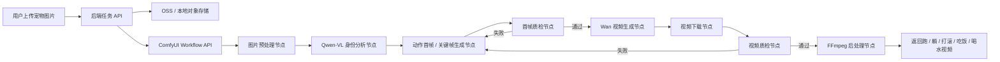

# ComfyUI 宠物侧面动作视频生成方案

## 1. 目标

用户上传一张宠物图片，系统自动生成同一只宠物的侧面动作视频：

- 跑步
- 躺着
- 打滚
- 吃饭
- 喝水

最终视频要求：

- 单只宠物，身份、毛色、脸部特征尽量保持一致
- 侧面展示，优先严格 side profile
- 全身完整入镜，不出画幅
- 固定镜头，不推拉、不旋转、不切换场景
- 白色或干净棚拍背景
- 输出统一为 16:9、5 秒、30 FPS、H.264 MP4

## 2. 总体思路

不要直接把用户原图送入图生视频模型。

图生视频模型强依赖首帧。如果原图是正面、半身、姿态不明确，模型很容易出现动作幅度小、毛色漂移、猫不吃饭、身体出画等问题。

推荐流程是：

1. 用户上传图片
2. 提取宠物身份特征
3. 生成侧面动作首帧或关键帧
4. 对首帧做质检和自动重试
5. 使用 Wan 图生视频或首尾帧视频生成动作视频
6. 对视频做抽帧质检和后处理
7. 返回五个动作视频

ComfyUI 在这里作为编排层，不直接承担所有重模型推理。优先调用云上模型，后续硬件足够时，再把云模型节点替换为本地模型节点。

## 3. 技术架构



## 4. 推荐模型

### 4.1 图片首帧生成

优先使用阿里云 DashScope / Model Studio：

- `qwen-image-edit-plus`
- `qwen-image-edit-max`
- `qwen-image-2.0-pro`

用途：

- 从用户上传图提取宠物身份
- 重绘成侧面全身图
- 生成跑步、躺着、打滚、吃饭、喝水的首帧或关键帧

参考文档：

- [Qwen 图像编辑 API](https://www.alibabacloud.com/help/en/model-studio/qwen-image-edit-api)

### 4.2 视频生成

优先使用阿里云 Wan 系列：

- 草稿：`wan2.2-i2v-flash`
- 质量版：`wan2.2-i2v-plus`
- 更推荐：支持首尾帧/更强动作控制的新版 Wan I2V 能力

用途：

- 将侧面动作首帧生成 5 秒视频
- 对跑步、打滚这类大动作，优先使用首尾帧或多段拼接

参考文档：

- [Wan 图生视频 API](https://www.alibabacloud.com/help/en/model-studio/image-to-video-general-api-reference)

### 4.3 后续本地替换

当前云上节点后续可以替换为：

- 图片编辑：本地 Qwen-Image-Edit、FLUX Kontext、IP-Adapter、InstantID 类方案
- 视频生成：本地 Wan2.1 / Wan2.2 I2V、FLF2V、VACE
- 抠图：本地 RMBG / BRIA-RMBG / rembg
- 质检：本地 Qwen2.5-VL / Qwen3-VL

## 5. ComfyUI 部署方式

推荐新增自定义节点包：

```text
ComfyUI-DashScope-PetVideo/
  __init__.py
  nodes/
    upload_image.py
    subject_normalize.py
    qwen_identity_analyze.py
    pose_prompt_builder.py
    qwen_pose_keyframe.py
    pet_frame_qc.py
    wan_video_submit.py
    wan_video_poll_download.py
    pet_video_qc.py
    video_postprocess.py
  workflows/
    pet_video_one_action_api.json
    pet_video_all_actions_api.json
  README.md
```

ComfyUI 使用 Workflow API 执行工作流：

- 导出 workflow 时打开 `Enable Dev Mode Options`
- 使用 `Save (API Format)` 保存 API 工作流
- 后端动态修改输入图片、动作、方向、seed、模型参数
- 通过 `POST /api/prompt` 提交任务
- 通过 WebSocket 或轮询读取执行状态
- 下载输出图片和视频

参考文档：

- [ComfyUI API / Cloud 概览](https://docs.comfy.org/development/cloud/overview)
- [ComfyUI Workflow API Format](https://docs.comfy.org/development/api-development/workflow-api-format)

## 6. Comfy 节点设计

### 6.1 `PetUploadImage`

功能：

- 接收用户上传图片
- 保存到本地工作目录或 OSS
- 输出本地路径、公开 URL、图片宽高、文件 hash

输入：

- `image_file`
- `user_id`
- `task_id`

输出：

- `image_path`
- `image_url`
- `image_width`
- `image_height`
- `image_sha256`

### 6.2 `PetSubjectNormalize`

功能：

- 抠出宠物主体
- 铺纯白背景
- 居中到 16:9
- 保留极淡接触阴影
- 输出后续模型使用的标准参考图

推荐本地实现：

- `rembg`
- `RMBG-2.0`
- `BRIA-RMBG`
- OpenCV 简单边缘检查

输出：

- `normalized_ref.png`
- `subject_rgba.png`
- `white_bg_ref.png`

### 6.3 `PetIdentityAnalyze`

功能：

- 调用 Qwen-VL 或本地 VL 模型
- 提取宠物身份特征
- 输出结构化 JSON，后续所有 prompt 复用

输出示例：

```json
{
  "species": "cat",
  "style": "cute 3D plush cartoon",
  "coat": "gray-brown tabby markings, white muzzle and large white chest",
  "face": "round face, pink nose, big glossy eyes",
  "body": "short chubby body, fluffy long fur",
  "must_keep": [
    "gray-brown forehead stripes",
    "white muzzle",
    "large white fluffy chest",
    "pink nose",
    "big glossy eyes"
  ],
  "must_avoid": [
    "orange cat",
    "black cat",
    "different face",
    "extra animal"
  ]
}
```

### 6.4 `PetPosePromptBuilder`

功能：

- 根据动作类型生成首帧 prompt、关键帧 prompt、视频 prompt
- 统一身份描述、背景描述、镜头描述、负面约束

输入：

- `identity_json`
- `action`
- `direction`
- `style_mode`
- `aspect_ratio`

动作枚举：

```text
run
lie
roll
eat
drink
```

方向枚举：

```text
facing_left
facing_right
```

### 6.5 `QwenPoseKeyframe`

功能：

- 调用 Qwen Image Edit
- 根据参考图和动作 prompt 生成侧面首帧/关键帧

建议参数：

```json
{
  "model": "qwen-image-edit-plus",
  "size": "1280*720",
  "watermark": false,
  "prompt_extend": true,
  "n": 1
}
```

输出：

- `keyframe_000.png`
- `keyframe_001.png`
- `keyframe_002.png`
- `keyframe_metadata.json`

### 6.6 `PetFrameQC`

功能：

- 检查首帧是否满足视频输入要求
- 不通过则换 seed 或升级模型自动重试

检查项：

- 是否只有一只宠物
- 是否全身完整入镜
- 是否侧面视角
- 是否背景干净
- 是否保持毛色和脸部特征
- 是否没有文字、水印、人手、其他动物
- 吃饭/喝水是否有碗
- 跑步是否有明确侧面奔跑姿态
- 打滚是否有明确翻滚关键姿态

输出：

```json
{
  "passed": true,
  "score": 0.91,
  "issues": [],
  "retry_hint": null
}
```

### 6.7 `WanVideoSubmit`

功能：

- 调用 Wan 图生视频接口
- 提交异步任务

输入：

- `first_frame`
- `last_frame`，可选
- `prompt`
- `model`
- `duration`
- `resolution`
- `seed`

建议参数：

```json
{
  "model": "wan2.2-i2v-plus",
  "duration": 5,
  "resolution": "1080P",
  "prompt_extend": false,
  "watermark": false
}
```

输出：

- `task_id`
- `request_json`
- `submit_time`

### 6.8 `WanVideoPollDownload`

功能：

- 轮询 DashScope 异步任务
- 下载 MP4 到本地或 OSS
- 保存结果 JSON

输出：

- `raw_video.mp4`
- `dashscope_result.json`
- `video_url`

### 6.9 `PetVideoQC`

功能：

- 抽帧检查视频质量
- 不通过则触发重试

检查项：

- 是否 5 秒
- 是否 30 FPS
- 是否单只宠物
- 是否侧面展示
- 是否出画
- 毛色是否漂移
- 背景是否明显变化
- 动作是否符合目标

动作专项检查：

- 跑步：四肢有明显交替运动
- 躺着：侧卧/趴卧稳定，有轻微呼吸或尾巴动作
- 打滚：身体有翻转过程，不切换成其他动物
- 吃饭：头部低到碗边或碗内，有咀嚼动作
- 喝水：头部低到水碗，有舔水动作或水面波纹

### 6.10 `VideoPostprocess`

功能：

- 使用 FFmpeg 统一输出规格
- 裁剪或补边为 16:9
- 固定 30 FPS
- 固定 5 秒
- 输出 H.264 MP4
- 生成预览图和分镜图

推荐命令：

```bash
ffmpeg -y -i raw_video.mp4 \
  -vf "scale=1920:1080:force_original_aspect_ratio=decrease,pad=1920:1080:(ow-iw)/2:(oh-ih)/2:white,fps=30,trim=end_frame=150,setpts=PTS-STARTPTS" \
  -an -c:v libx264 -crf 18 -preset slow -pix_fmt yuv420p -movflags +faststart \
  final_5s_30fps_16x9.mp4
```

## 7. 五类动作实现方案

### 7.1 跑步 `run`

难点：

- 单首帧 I2V 容易只轻微晃动
- 大幅跑步容易变形或出画

推荐方案：

- 生成两张侧面关键帧
- 第一张：前腿 A 向前，后腿 B 向后
- 第二张：腿部交替
- 使用首尾帧视频或分段视频生成
- 输出后做循环检查

首帧 prompt 要点：

```text
同一只宠物，严格侧面视图，四肢奔跑姿态，全身完整入镜。
前后腿明显交替伸展，身体水平向前，尾巴向后保持平衡。
纯白背景，固定镜头，16:9。
```

视频 prompt 要点：

```text
侧面奔跑循环，四肢清晰交替运动，身体始终在画面中央。
镜头固定，不推拉，不旋转，不切换场景。
保持同一只宠物的毛色、脸部特征和身体比例。
```

### 7.2 躺着 `lie`

难点：

- 动作幅度较小，容易看起来像静态图

推荐方案：

- 生成侧卧或趴卧首帧
- 视频动作强调轻微呼吸、耳朵抖动、尾巴轻摆

首帧 prompt 要点：

```text
同一只宠物，严格侧面视图，趴在地上或侧卧。
腹部贴近地面，前爪自然向前，后腿收在身体侧后方。
全身完整入镜，白色背景，16:9。
```

视频 prompt 要点：

```text
宠物安静躺着，胸口有轻微呼吸起伏，耳朵轻微抖动，尾巴轻轻摆动。
固定镜头，侧面展示，全身不出画。
```

### 7.3 打滚 `roll`

难点：

- 一次性生成完整打滚容易身份漂移
- 模型可能切场景或变成多只宠物

推荐方案：

- 生成 3 张关键帧
  1. 侧躺起始
  2. 肚皮朝上
  3. 翻到另一侧
- 分两段生成视频
  1. 侧躺 -> 仰躺
  2. 仰躺 -> 另一侧躺
- 最后拼接成 5 秒

关键帧 prompt 要点：

```text
同一只宠物，白色背景，全身完整入镜。
侧面展示，正在地上打滚，身体圆润柔软，四肢自然蜷缩。
不要切换成其他动物，不要多只宠物。
```

视频 prompt 要点：

```text
宠物在原地打滚，从侧躺平滑翻到肚皮朝上，再翻向另一侧。
动作可爱自然，身体始终完整入镜，镜头固定。
```

### 7.4 吃饭 `eat`

难点：

- 如果首帧头太高，I2V 很难让头低到碗里
- 碗和猫嘴位置必须在首帧里已经接近

推荐方案：

- 首帧直接生成侧面蹲姿或站姿
- 猫嘴靠近蓝色陶瓷猫碗
- 碗里有猫粮
- 视频只负责小幅低头、咀嚼、耳朵和胡须动作

首帧 prompt 要点：

```text
同一只宠物，严格侧面视图，头部已经低到蓝色陶瓷猫碗边缘。
碗中有猫粮，猫嘴靠近猫粮，身体全身完整入镜。
纯白背景，固定构图，16:9。
```

视频 prompt 要点：

```text
宠物低头在碗里吃猫粮，轻轻咀嚼，头部小幅上下移动。
耳朵轻微抖动，胡须自然移动，尾巴轻摆。
镜头固定，全身不出画，不切换场景。
```

### 7.5 喝水 `drink`

难点：

- 舌头/水面细节较难稳定
- 容易被模型误解成吃饭

推荐方案：

- 首帧生成透明或浅蓝水碗
- 猫嘴靠近水面
- 视频提示舔水、水面轻微波纹

首帧 prompt 要点：

```text
同一只宠物，严格侧面视图，低头靠近浅蓝水碗。
水碗里有清水，猫嘴接近水面。
全身完整入镜，白色背景，16:9。
```

视频 prompt 要点：

```text
宠物低头喝水，舌头轻轻舔水，水面有细微波纹。
头部小幅前后移动，耳朵和胡须轻微运动。
镜头固定，侧面展示，全身不出画。
```

## 8. 后端服务设计

### 8.1 服务组件

```text
frontend/
  upload page
  task status page
  video preview page

backend/
  FastAPI or Node.js API
  task manager
  ComfyUI workflow client
  DashScope credential manager
  OSS client
  FFmpeg worker

comfy-worker/
  ComfyUI
  ComfyUI-DashScope-PetVideo
  custom workflow json

storage/
  input images
  normalized references
  keyframes
  raw videos
  final videos
  metadata json
```

### 8.2 API 设计

#### 创建任务

```http
POST /api/pet-video/tasks
Content-Type: multipart/form-data
```

请求字段：

```text
image: file
actions: run,lie,roll,eat,drink
direction: facing_left | facing_right | both
style: cartoon_3d_plush
duration: 5
fps: 30
aspect_ratio: 16:9
quality: draft | standard | high
```

返回：

```json
{
  "task_id": "pv_20260617_001",
  "status": "queued"
}
```

#### 查询任务

```http
GET /api/pet-video/tasks/{task_id}
```

返回：

```json
{
  "task_id": "pv_20260617_001",
  "status": "running",
  "progress": 0.55,
  "actions": {
    "run": {"status": "running"},
    "lie": {"status": "succeeded", "video_url": "..."},
    "roll": {"status": "queued"},
    "eat": {"status": "succeeded", "video_url": "..."},
    "drink": {"status": "running"}
  }
}
```

#### 下载结果

```http
GET /api/pet-video/tasks/{task_id}/download
```

返回：

- ZIP 包
- 包含五个 MP4、首帧 PNG、分镜 JPG、metadata JSON

### 8.3 队列设计

推荐任务拆分：

```text
PetVideoTask
  AnalyzeIdentityJob
  NormalizeImageJob
  ActionJob(run)
  ActionJob(lie)
  ActionJob(roll)
  ActionJob(eat)
  ActionJob(drink)
  PackageResultJob
```

五个动作可以并发执行，但每个动作内部需要按顺序：

```text
生成首帧 -> 首帧质检 -> 视频生成 -> 视频质检 -> 后处理
```

建议队列：

- Redis Queue
- Celery
- Dramatiq
- BullMQ

## 9. 自动重试策略

### 9.1 首帧失败

失败原因：

- 不是侧面
- 没有全身
- 毛色变了
- 背景不白
- 多了一只宠物
- 吃饭/喝水缺少碗

重试顺序：

1. 同模型换 seed
2. 强化 prompt 的失败约束
3. 升级模型
4. 改为先生成无背景主体，再合成白底
5. 人工审核

### 9.2 视频失败

失败原因：

- 动作太小
- 宠物出画
- 毛色漂移
- 场景切换
- 生成多只宠物
- 吃饭/喝水动作不明显

重试顺序：

1. 使用更强动作首帧
2. 增加末帧/关键帧
3. 降低动作复杂度
4. 分段生成再拼接
5. 升级视频模型

## 10. 文件命名规范

```text
tasks/{task_id}/
  input/
    user_upload.png
  ref/
    normalized_ref.png
    subject_rgba.png
    identity.json
  keyframes/
    run_000.png
    run_001.png
    lie_000.png
    roll_000.png
    roll_001.png
    roll_002.png
    eat_000.png
    drink_000.png
  raw_videos/
    run_raw.mp4
    lie_raw.mp4
    roll_part_01_raw.mp4
    roll_part_02_raw.mp4
    eat_raw.mp4
    drink_raw.mp4
  final/
    run_5s_30fps_16x9.mp4
    lie_5s_30fps_16x9.mp4
    roll_5s_30fps_16x9.mp4
    eat_5s_30fps_16x9.mp4
    drink_5s_30fps_16x9.mp4
    contact_sheet.jpg
    result.json
```

## 11. Prompt 模板

### 11.1 通用身份描述

```text
输入图片只作为宠物身份、毛色、脸部特征和 3D 卡通风格参考，不保留原图构图、姿态、背景和裁切。
请生成同一只宠物，保留它的主要毛色分布、脸部特征、眼睛、鼻子、毛发长度、体型比例。
画面中只能有一只宠物。
```

### 11.2 通用构图描述

```text
严格侧面视图，side profile view。
宠物全身完整入镜，头、耳朵、四肢、尾巴都不能裁切。
16:9 横版构图，主体居中，留足边距。
纯白背景 #FFFFFF，柔和棚拍光，最多只有极淡接触阴影。
不要文字、水印、人手、其他动物、复杂背景、室内家具、地板线。
```

### 11.3 通用视频描述

```text
固定镜头，侧面展示，不推拉，不旋转，不切换场景。
宠物始终完整留在画幅内。
保持同一只宠物的毛色、脸部特征、身体比例和 3D 毛绒卡通质感。
动作自然、清晰、平滑，可循环。
```

### 11.4 通用负面描述

```text
不要正面视角，不要背面视角，不要半身，不要裁切，不要只有头像。
不要多只宠物，不要人手，不要文字，不要水印，不要复杂背景。
不要改变毛色，不要变成橘猫、黑猫或其他品种。
不要多头、多尾、多腿、畸形、模糊、低清晰度。
```

## 12. 安全和配置

### 12.1 API Key

不要把 API Key 写入 workflow JSON。

推荐：

```text
DASHSCOPE_API_KEY=sk-xxxx
```

由 Comfy 自定义节点从环境变量读取。

本地开发可以使用：

```text
.env
```

生产环境使用：

- Kubernetes Secret
- Docker Secret
- 云服务器环境变量
- 密钥管理服务 KMS

### 12.2 请求记录

请求 JSON 需要保存，但必须脱敏：

```json
{
  "model": "wan2.2-i2v-plus",
  "duration": 5,
  "resolution": "1080P",
  "seed": 20260711,
  "api_key": "***"
}
```

## 13. 最小可行版本

第一阶段只做三个动作：

- 躺着
- 吃饭
- 喝水

原因：

- 动作幅度较小
- 单首帧 I2V 更容易稳定
- 质量问题更容易通过 prompt 和首帧修正

第二阶段再做：

- 跑步
- 打滚

原因：

- 需要多关键帧
- 需要分段生成
- 需要更强视频质检

## 14. 里程碑

### Milestone 1: 云上单动作闭环

目标：

- 用户上传图片
- 生成吃饭首帧
- 生成 5 秒吃饭视频
- 输出 16:9、30 FPS MP4

交付：

- `QwenPoseKeyframe`
- `WanVideoSubmit`
- `WanVideoPollDownload`
- `VideoPostprocess`
- 单动作 Comfy API workflow

### Milestone 2: 三动作稳定版

目标：

- 支持躺着、吃饭、喝水
- 支持失败自动重试
- 支持分镜预览和质量分数

交付：

- `PetFrameQC`
- `PetVideoQC`
- 三动作并发生成

### Milestone 3: 五动作完整版

目标：

- 支持跑步、躺着、打滚、吃饭、喝水
- 跑步和打滚使用关键帧/分段生成
- 输出完整 ZIP 包

交付：

- 多关键帧生成
- 视频拼接
- 任务状态 API
- 前端预览页

### Milestone 4: 本地模型替换

目标：

- 保留 Comfy 节点接口不变
- 将云 Qwen/Wan 节点替换成本地模型节点

交付：

- 本地 Qwen 图像节点
- 本地 Wan I2V 节点
- 本地 VL 质检节点

## 15. 推荐默认参数

```json
{
  "image_size": "1280*720",
  "video_duration": 5,
  "video_fps": 30,
  "aspect_ratio": "16:9",
  "background": "pure white",
  "camera": "fixed side view",
  "qwen_model": "qwen-image-edit-plus",
  "wan_model_draft": "wan2.2-i2v-flash",
  "wan_model_quality": "wan2.2-i2v-plus",
  "watermark": false,
  "prompt_extend_for_image": true,
  "prompt_extend_for_video": false,
  "max_keyframe_retries": 3,
  "max_video_retries": 2
}
```

## 16. 结论

最佳实现方式是：

```text
ComfyUI 编排 + Qwen 生成动作首帧/关键帧 + Wan 生成视频 + VL 质检 + FFmpeg 后处理
```

这个方案的关键不是单次 prompt，而是把任务拆成可控节点：

- 身份提取
- 姿态重绘
- 首帧质检
- 视频生成
- 视频质检
- 自动重试
- 规格统一

这样当前可以优先使用云上模型快速落地，后续也能在显卡和模型配置足够时迁移到本地开源模型。
