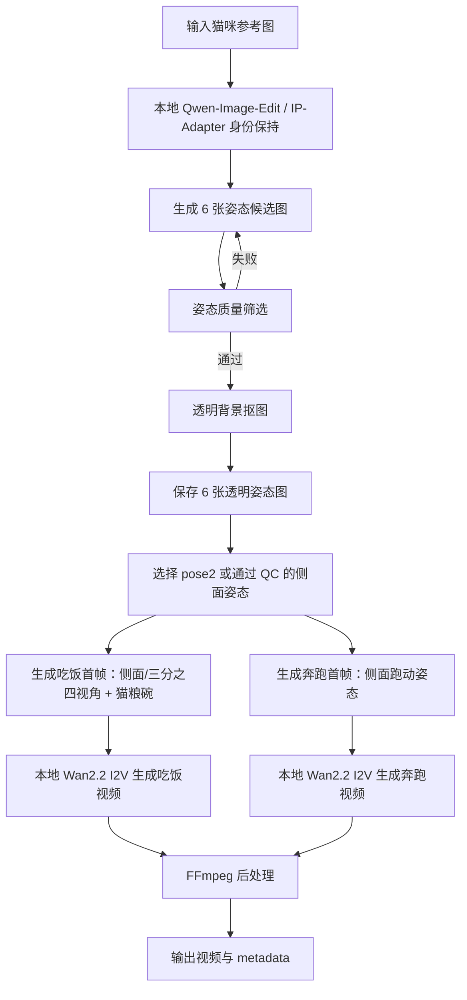

# 纯开源模型猫咪图片到视频生成链路文档

## 1. 文档目标

本文档描述一条不依赖百炼 / DashScope API 的本地开源模型链路：

```text
一张猫咪参考图
  -> 本地开源图像模型生成 6 张姿态图
  -> 本地开源视频模型生成吃饭 / 奔跑等动作视频
  -> FFmpeg 后处理统一规格
```

本文件不记录当前 `cat_two_action_pipeline_wan22_side_eat` 目录下的实际输出图片，因为其中：

- `pose_01_transparent.png`
- `pose_04_transparent.png`
- `pose_05_transparent.png`

存在形象或姿态跑偏问题，先不纳入正式文档示例。

跑偏产物已单独记录在 [`PET_VIDEO_DRIFT_RECORD.md`](PET_VIDEO_DRIFT_RECORD.md)，用于复盘原因和后续修复方案。

## 2. 原则

这版链路必须满足：

- 不调用 DashScope / 百炼云端 API
- 不使用 `apikey.txt`
- 不使用 `qwen-image-edit`、`qwen-image-edit-plus`、`wan2.2-i2v-flash` 这类云端 API model id
- 图像生成、图像编辑、图生视频均使用本地开源权重
- 所有产物必须经过质量筛选后再写入文档

## 3. 开源模型选择

### 3.1 图像与姿态生成

推荐使用：

| 模块 | 开源模型 | 用途 |
| --- | --- | --- |
| 图像编辑 / 姿态重绘 | Qwen-Image / Qwen-Image-Edit 系列 | 从参考猫图生成 6 个姿态图 |
| 边缘 / 深度 / 姿态控制 | ControlNet / Canny / Depth / OpenPose 类控制模型 | 降低姿态跑偏概率 |
| 背景去除 | RMBG / BRIA-RMBG / rembg | 生成透明 PNG |

参考：

- [Qwen-Image GitHub](https://github.com/QwenLM/Qwen-Image)
- [Qwen-Image-Edit-2509 介绍](https://github.com/QwenLM/Qwen-Image/blob/main/Qwen-Image-Edit-2509.md)

### 3.2 视频生成

推荐使用 Wan2.2 本地开源权重：

| 模型 | 类型 | 推荐用途 |
| --- | --- | --- |
| `Wan2.2-TI2V-5B` | 文生视频 + 图生视频混合模型 | 优先用于本地验证，模型较小 |
| `Wan2.2-I2V-A14B` | 图生视频模型 | 质量更高，但显存压力更大 |

参考：

- [Wan2.2 GitHub](https://github.com/Wan-Video/Wan2.2)
- [Wan-AI Hugging Face](https://huggingface.co/Wan-AI)
- [ComfyUI Wan2.2 官方工作流说明](https://docs.comfy.org/tutorials/video/wan/wan2_2)
- [ComfyUI Wan2.2 示例](https://comfyanonymous.github.io/ComfyUI_examples/wan22/)

## 4. 当前环境差距

当前机器信息：

| 项目 | 当前状态 |
| --- | --- |
| GPU | NVIDIA GeForce RTX 4060 |
| 当前 Comfy 环境 torch | `2.12.0+cpu` |
| CUDA 可用性 | 当前 Python 环境内 `torch.cuda.is_available() == False` |
| ComfyUI 启动方式 | `--cpu` |

因此当前环境不能直接完成“完全本地开源模型推理”。需要先补齐：

1. CUDA 版 PyTorch
2. Wan2.2 本地权重
3. Qwen-Image-Edit 本地权重
4. ComfyUI 本地工作流
5. 显存优化方案

注意：Wan2.2 官方资料中，`TI2V-5B` 面向 720P / 24fps 本地图生视频，但仍更适合 24GB 级别显存机器验证。RTX 4060 如果是 4GB 或 8GB 显存，需要使用低分辨率、量化权重、CPU offload、分块 VAE、GGUF / FP8 等优化方案，速度会明显变慢。

## 5. 推荐技术架构



## 6. ComfyUI 本地模型目录

按照 ComfyUI 官方 Wan2.2 示例，模型建议放入：

```text
ComfyUI/models/
  diffusion_models/
    wan2.2_ti2v_5B_fp16.safetensors
    wan2.2_i2v_high_noise_14B_fp8_scaled.safetensors
    wan2.2_i2v_low_noise_14B_fp8_scaled.safetensors

  text_encoders/
    umt5_xxl_fp8_e4m3fn_scaled.safetensors

  vae/
    wan2.2_vae.safetensors
    wan_2.1_vae.safetensors

  clip_vision/
    根据工作流要求放置图像编码器

  controlnet/
    可选：Canny / Depth / pose 控制模型

  loras/
    可选：猫咪风格、毛绒、3D 卡通等 LoRA
```

说明：

- `Wan2.2-TI2V-5B` 需要 `wan2.2_vae.safetensors`
- `Wan2.2-I2V-A14B` 工作流通常需要 high-noise 与 low-noise 两个扩散权重
- 14B 模型显存压力更高，优先用 5B 跑通闭环

## 7. 纯开源工作流拆分

### 7.1 姿态图生成

目标输出：

```text
outputs/open_source_pet_video/
  poses/
    raw/
      pose_01_raw.png
      pose_02_raw.png
      pose_03_raw.png
      pose_04_raw.png
      pose_05_raw.png
      pose_06_raw.png
    transparent/
      pose_01_transparent.png
      pose_02_transparent.png
      pose_03_transparent.png
      pose_04_transparent.png
      pose_05_transparent.png
      pose_06_transparent.png
    accepted/
      pose_02_transparent.png
      ...
    rejected/
      pose_01_transparent.png
      pose_04_transparent.png
      pose_05_transparent.png
```

六个建议姿态：

| 编号 | 姿态 | 质量要求 |
| --- | --- | --- |
| pose1 | 正面坐姿 | 身份必须像，不允许脸谱跑偏 |
| pose2 | 侧面站姿 | 优先用于奔跑 / 吃饭 |
| pose3 | 趴卧 | 全身完整 |
| pose4 | 伸展 / 玩耍 | 不允许身体比例崩坏 |
| pose5 | 抬爪挥手 | 爪子不能多指或变形 |
| pose6 | 蜷缩睡觉 | 脸部身份稳定 |

### 7.2 吃饭首帧

吃饭视频必须用偏侧视角，不使用正面居中吃饭。

推荐首帧 prompt：

```text
same cat identity, cute 3D plush cartoon style,
three-quarter side view, about 35 to 45 degrees from the front,
the cat is eating dry cat food from a small blue ceramic bowl,
the bowl is in front of the mouth and slightly toward the visible side,
full body visible, clean pure white background, fixed camera,
no humans, no extra animals, no text, no watermark
```

负面约束：

```text
front view, straight-on view, multiple cats, extra animal, human, hand,
cropped body, deformed legs, extra legs, missing tail, no bowl,
empty bowl, water bowl, text, watermark, complex background
```

### 7.3 奔跑首帧

推荐首帧 prompt：

```text
same cat identity, cute 3D plush cartoon style,
side view running pose, moving left to right,
four legs in a natural running stride, tail balanced behind body,
full body visible, clean pure white background, fixed camera,
no humans, no text, no watermark
```

## 8. 视频生成参数

### 8.1 Wan2.2-TI2V-5B 推荐起步参数

| 参数 | 建议值 |
| --- | --- |
| 分辨率 | 720P；显存不足时先降到 480P 或更低 |
| 帧率 | 24fps |
| 时长 | 3-5 秒 |
| 采样步数 | 先用低步数测试，再提高 |
| 输出 | 先输出原始视频，再统一后处理 |

### 8.2 后处理统一规格

```powershell
ffmpeg -y -i input.mp4 `
  -vf "scale=1920:1080:force_original_aspect_ratio=decrease,pad=1920:1080:(ow-iw)/2:(oh-ih)/2:white,fps=30,trim=end_frame=150,setpts=PTS-STARTPTS" `
  -an -c:v libx264 -crf 18 -preset slow -pix_fmt yuv420p -movflags +faststart `
  output_5s_30fps_16x9.mp4
```

## 9. 质量筛选规则

### 9.1 姿态图 QC

每张姿态图必须检查：

- 是否仍是同一只猫
- 脸部花纹是否稳定
- 身体比例是否接近参考图
- 是否只有一只猫
- 是否全身完整
- 是否透明背景干净
- 是否有多余道具、文字、水印

失败图不写入正式文档，不进入动作视频生成。

本次明确暂不记录的失败图：

```text
D:/gogelila/comfy/outputs/cat_two_action_pipeline_wan22_side_eat/poses/transparent/pose_01_transparent.png
D:/gogelila/comfy/outputs/cat_two_action_pipeline_wan22_side_eat/poses/transparent/pose_04_transparent.png
D:/gogelila/comfy/outputs/cat_two_action_pipeline_wan22_side_eat/poses/transparent/pose_05_transparent.png
```

### 9.2 视频 QC

每段视频必须检查：

- 动作是否明确：吃饭必须真的低头接触猫粮碗，奔跑必须有腿部运动
- 视角是否正确：吃饭必须偏侧，不要纯正面
- 身份是否稳定：毛色、脸、尾巴不能频繁漂移
- 是否出画：头、耳朵、尾巴、爪子不能被裁掉
- 背景是否干净
- 是否没有文字和水印

## 10. ComfyUI 工作流建议

### 10.1 节点组

建议拆成四个 group：

```text
Group A: Reference Prepare
  Load Image
  Resize / Pad to Square
  Optional: Background Remove

Group B: Pose Generation
  Qwen-Image-Edit local node
  ControlNet / Canny / Depth condition
  Save 6 pose candidates
  Manual or automatic QC

Group C: Action Keyframes
  Load accepted pose
  Add eating bowl / running pose via local edit model
  Save keyframes

Group D: Video I2V
  Wan2.2 I2V local workflow
  VAE decode
  Save video
  FFmpeg postprocess
```

### 10.2 输出字段

建议 metadata 结构：

```json
{
  "pipeline": "open_source_local_pet_video",
  "api_used": false,
  "models": {
    "image_edit": "Qwen-Image-Edit local",
    "video": "Wan2.2 local",
    "background_remove": "RMBG/rembg local"
  },
  "input_image": "...",
  "accepted_poses": [],
  "rejected_poses": [],
  "videos": {
    "eat": {
      "keyframe": "...",
      "raw_video": "...",
      "final_video": "..."
    },
    "run": {
      "keyframe": "...",
      "raw_video": "...",
      "final_video": "..."
    }
  }
}
```

## 11. 推荐落地步骤

第一阶段：只跑开源视频模型

1. 保留当前已经比较稳定的 pose2 或手工挑选一张干净侧面图
2. 下载 Wan2.2-TI2V-5B 或 Wan2.2-I2V-A14B 权重
3. 在 ComfyUI 中跑通单张图生 3-5 秒视频
4. 确认显存、速度、视频质量

第二阶段：替换图像生成

1. 下载 Qwen-Image-Edit 本地权重
2. 用本地图像编辑模型生成六姿态图
3. 加入 ControlNet / Depth / Canny 约束
4. 建立姿态图 QC 目录

第三阶段：合并全链路

1. ComfyUI Workflow API 或自定义节点串联全流程
2. 自动写 metadata
3. 自动输出预览拼图
4. 只将 QC 通过的结果写入正式文档

## 12. 与当前 API 链路的区别

| 项目 | 当前 API 链路 | 纯开源本地链路 |
| --- | --- | --- |
| 图像模型 | DashScope API | 本地 Qwen-Image-Edit 权重 |
| 视频模型 | DashScope API | 本地 Wan2.2 权重 |
| 是否需要 apikey | 需要 | 不需要 |
| 推理位置 | 云端 | 本机 |
| 速度 | 取决于云端排队 | 取决于本机 GPU |
| 成本 | API 计费 | 本地电费和硬件成本 |
| 可控性 | 中等 | 更高，可改 workflow 和采样参数 |
| 部署难度 | 低 | 高 |

## 13. 当前结论

`Wan2.2` 与 `Qwen-Image / Qwen-Image-Edit` 都有开源方向可用于搭建纯本地链路；ComfyUI 也已有 Wan2.2 官方工作流示例。

但当前 `comfy-pet-video` 环境仍是 CPU 版 PyTorch，且本地 ComfyUI 模型目录尚未放入 Wan2.2 / Qwen-Image-Edit 权重，因此本文档是纯开源本地化方案文档，不代表当前机器已经完成本地全链路推理。

下一步如果要实际跑通，需要先处理：

1. CUDA 版 torch 环境
2. Wan2.2 模型权重下载与 ComfyUI 工作流
3. Qwen-Image-Edit 本地推理节点
4. 4GB / 8GB 显存下的量化与 offload 策略
