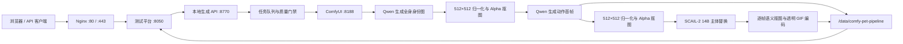

# 萌宠图片与视频生成平台

本项目是一套部署在单机 GPU 服务器上的萌宠生成与主体替换系统。当前候选版本为 `local-video-api v2.22.0`（参考链 `1.32.0`），支持单图兼容与正面/左侧/右侧三视角 canonical 身份输入，并隔离上传宠物身份与 Main_case 动作 Profile 的外观词条。

`v2.22.0` 将生成物的视觉内容审核改为默认仅记录、不中断链路。吃饭和舔毛线路只在运行完整性问题上失败：必需模型/驱动素材缺失或摘要变化、Qwen/SCAIL 进程失败、图片无法解码、归一化结果不是可用的 `512×512 RGBA`、透明前景为空，以及 MP4/GIF 产物缺失。三视图重复度、身份色盘、姿态相似度、舔爪语义、毛面纹理、最终视频抽帧和 GIF 毛边等视觉判断不再触发失败或多轮审核重试；默认每个 canonical/动作只取一次可用 Qwen 结果，随后进入归一化、抠图和 SCAIL。任务与 `/health` 会把这些项目标记为 `skipped_advisory`。如需复现旧的严格审核行为，可显式设置 `LOCAL_VIDEO_VISUAL_AUDIT_MODE=strict`；生产默认无需设置该变量。

`v2.21.43` 修复 v2.21.42 同三视图实测任务 `20260806T233309Z-945c2ef728` 中第 4 轮 Qwen 已生成完整真实舔爪姿态、但 rembg 把浅色身体误删，导致姿态门只看到残缺主体的问题。第 4/5 轮现在使用“语义宠物 Alpha + SHA 绑定确定性动作种子 Alpha”的并集恢复遮罩；动作种子只贡献 Alpha 几何，不复制任何 RGB、亮度、色度或纹理，且语义/种子覆盖、面积、连通域和摘要必须全部通过失败关闭合同。只有第 4 轮在该遮罩下同时通过完整主体、原始舔毛姿态、严格 Main_case chamfer 对齐（`>=0.70 / <=5 px / <=12 px`）、低通有机前肢结构（`>=0.02`）和独立毛面门，并且身份问题严格限定为可重绘的暖色/白灰明度漂移时，才可成为第 5 轮 Image 1；Image 2 仍是三视图 canonical 唯一身份与画风权威，Image 3 是同一摘要绑定的低频动作种子，仅复核姿态。悬挂物、爪材质不一致、结构不足、额外色盘问题或任一摘要异常都不能进入身份回正，最终候选仍须重新通过全部身份、姿态、毛面和视频门禁。

`v2.21.42` 修复 v2.21.41 同三视图实测任务 `20260806T230339Z-1e8a2e33df` 中“真实舔爪候选已完整通过姿态门，却因白/灰明度比例漂移继续被身份门拒绝”的问题。第 1 轮候选具有连续毛质抬爪、嘴爪接触和严格 Main_case 对齐，姿态、抬爪/落地爪材质及独立毛面指标均合格，但 canonical 白/灰分布 L1 为 `0.884647`。新版不直接放行该漂移：仅限前两轮且已由严格 off-guide 或 aligned organic-paw 证据确认的无新增色候选，确定性地只把透明前景的 LAB-L 直方图匹配到 SHA 绑定 canonical；Alpha 几何逐像素保持，LAB A/B 色度只允许 RGB 往返误差 `<=2`，不复制 canonical 空间像素。归一化输出必须重新通过完整舔毛姿态门与 canonical 身份色盘门，随后仍执行独立首帧毛面门和最终视频审计；任一证据、变换或复验异常都失败关闭。棕色悬挂物样本因低通结构、严格对齐和两爪材质证据不足，不能进入该归一化路径。

`v2.21.41` 修复 v2.21.40 同源实测任务 `20260806T223949Z-6967ed0ffe` 暴露的“导图对齐优于动作语义”误选。该任务第 1 轮候选目视为连续肩臂、真实毛爪接触嘴部的白灰宠物，独立毛面门也通过，却只因相对导图存在有限偏移和 canonical 白/灰明度重分配而被拒；第 2/3/5 轮反而把嘴边悬挂物对齐到导图通道。新版增加仅限前两轮的失败关闭证据：原姿态问题必须且只能是两项导图偏移，原始与低通毛边、连续前肢、嘴爪接触均须通过，抬爪与落地爪还必须满足更严格的 LAB、直方图和纹理一致性；色盘只允许无新增色、无暗纹丢失或扩张的有界白灰明度重分配，随后仍必须通过独立毛面与最终视频审计。全局姿态、身份、毛面阈值未修改，棕色、米色或材质不一致的悬挂物不具备该证据。

`v2.21.40` 修复 v2.21.39 同三视图双动作实测任务 `20260806T222249Z-f36b5ea709` 暴露的动作覆盖。中性动作底图已经消除了棕色弯条并恢复白银身份，但第 4/5 轮同时输入 canonical 与上传正面照，两张中立坐姿身份图会共同压过唯一的舔爪动作底图，输出再次退化为双前爪落地。新版仍在 canonical 阶段使用正面、左侧、右侧三视图完整建立身份；舔毛恢复阶段则严格使用“动作底图 Image 1 + 三视图 canonical Image 2”双输入，不再重复暴露带中立姿态的原始正面照。canonical 已是三视图身份共识和唯一外观权威，动作底图是唯一姿态权威；拒绝候选仍不得成为 sampler，所有门禁与阈值保持不变。

`v2.21.39` 修复 v2.21.38 三视图双动作实测任务 `20260806T212430Z-f898a127ea` 的舔毛恢复误判：公开 open-channel 导图中的弧形绿洞被 Qwen 解释成嘴边悬挂的棕色弯条，旧链路又把这种已被身份色盘门拒绝的深色候选继续作为第 4/5 轮姿态 sampler，导致白银 canonical 身份无法回正。新版从 SHA 绑定的原始舔毛动作参考确定性生成低频、高亮、去色的动作几何底图，只保留真实抬爪与舔爪轮廓，不暴露 Main_case 的原始 RGB、色度、纹理或高频亮度；恢复轮固定使用该底图作为 Image 1、canonical 作为 Image 2 唯一目标形象与画风权威、上传正面图作为 Image 3 身份佐证。任何被色盘门拒绝的 Qwen 候选均不得再成为 sampler，弧形物件误判也不能升级为恢复权威；身份、姿态、毛面和最终视频门禁阈值均未放宽。

`v2.21.38` 修复 v2.21.37 三视图双动作实测任务 `20260806T205549Z-835db62096` 中“抬爪姿态已经正确、身份回绘却选错底稿”的问题。公开 open-channel 导图已使舔毛前 3 个 Qwen 候选全部通过抬爪姿态门，但它们因白/灰比例漂移被身份色盘门正确拒绝；旧第 4 轮从几何图重新起稿后丢失抬爪，第 5 轮又以该错误候选和中立坐姿正面照回绘，最终退化为行走姿态。新版会在前 4 轮持续保存 SHA 绑定、Alpha 可靠、身体完整且已通过独立舔毛姿态门的最佳候选，按“身份色盘是否通过→色盘罚分→姿态罚分→轮次”确定唯一恢复源；第 4/5 轮优先以该候选作为 Image 1 姿态 sampler、canonical 作为 Image 2 唯一身份/画风权威，并以同一公开单灰 open-channel 图作为 Image 3 纯动作几何佐证。原始正面照不再参与舔毛身份回绘，避免其双爪落地构图覆盖已验证抬爪；若没有任何姿态安全源，仍使用公开导图执行有限完整姿态救援。身份、姿态、毛面和最终视频门禁均未放宽。

`v2.21.37` 修复 v2.21.36 双动作实测任务 `20260806T195618Z-0d2529589a` 的舔毛确定性中性坐姿回退。该任务公开单色图抹掉了位于主体外轮廓内部的抬爪边界，Qwen 第 2、3 轮因此生成双前爪落地白猫，第 4、5 轮读取多级私有 CV 恢复图后仍保持中性坐姿并漂移成黑白花色。新公开 Image 2 仍只有统一 `RGB(144,144,144)` 主体灰值，不暴露第二灰值、Main_case RGB/亮度、纹理或封闭胶囊；它仅按私有门禁已验证的爪心、肩点和前肢框构造一条纯绿、两端开放、非等宽直柱的有机弯曲负空间，使躯干侧抬爪边界可读，同时保留爪口接触和肩部连接。第 3 轮 Image 3 与第 4 轮 sampler 统一复用这张 SHA 绑定公开图，私有多级 CV 图恢复为仅验收输入，避免再次借出黑白花色。公开/私有前景差分、曲线连通性、像素面积、单一前景色、路径和 SHA 均失败关闭；身份色盘、姿态、首帧毛面与最终视频全部阈值不变。

`v2.21.36` 修复 v2.21.35 实测任务 `20260806T190008Z-228a717487` 的舔毛真阳性误拒。该任务第 2、3 个 Qwen 候选均保持白猫身份并形成圆润抬爪，只因浅色抗锯齿让原始边缘密度分别为 `0.102601/0.102244`、略低于不变的全局 `0.11` 而被拒；随后第 4、5 次恢复才漂移成黑白花色。新增 `canonical_direct_organic_foreleg_structural_edge_evidence_v1` 仅作用于 canonical 直出第 1–2 次：必须只有原始边缘一项失败，原始密度达到全局阈值的 `92.5%`，低通有机结构密度 `>=0.03`，并同时满足更严格的 Main_case 对齐（chamfer 覆盖 `>=0.70`、平均距离 `<=5 px`、P90 `<=12 px`）和原有连续前肢、爪口接触、两爪颜色/直方图/纹理合同。历史硬直圆柱伪前爪样本虽有相近边缘密度，但覆盖仅 `0.631844–0.632565`、平均距离 `6.789175–6.996345 px`，因此仍失败关闭。真实重放还发现通过姿态和身份的第 2 个候选仅剩 `brush_texture_coherence`，且相对摘要绑定的透明 canonical，粗纹理 `0.189035 < 0.231426`、径向纹理 `0.349006 < 0.473662`、长线能量 `0.200332 < 0.244178`，只有结构一致像素比例增加 `0.004658`。新增 `canonical_direct_identity_surface_debt_nonexpansion_v1` 只允许这个单一既存问题，要求上述纹理/线条指标全部有界且不扩张、严格姿态恢复与身份色板已通过、canonical 文件摘要一致，并保留独立最终视频审计。全局姿态、首帧毛发和成片阈值均保持不变。

`v2.21.35` 修复 v2.21.34 实测任务 `20260806T182918Z-2ae96f852b` 的舔毛首帧假阳性。该任务的 Qwen 首帧实际是双前爪落地的普通坐姿，但胸前细密毛纹让原始 Canny、chamfer、连续边缘和爪口间距同时误通过；SCAIL 随后按 driver 正确抬爪时，相对错误首帧基准产生持续轮廓毛边、粗笔触与长线增量，最终视频门禁在 `20–80` 帧正确失败关闭。姿态门升级为 `main_case_grooming_raised_paw_cv_v3 / 3.0`：保留原 `0.11` 细边缘及全部 Main_case/接触/两爪外观阈值，并新增 `sigma=4.0` 高斯低通后的有机前肢结构密度硬门 `>=0.015`。低通会消除孤立毛丝，只允许肩—肘—腕—爪的中低频边界提供结构证据；该错误首帧实测为 `0.009488`，冻结 Main_case 舔毛参考为 `0.022096`。最终视频门禁未放宽。

`v2.21.34` 修复 v2.21.33 实测任务 `20260806T180559Z-8766e9478c` 暴露的低对比直条语义问题。v2.21.33 第 4 轮已把身份色盘 L1 从旧奶牛纹失败降到 `0.187019 < 0.40` 并通过白猫身份门，但 Qwen 仍把相差 8 级的笔直前腿标签画成麦克风，导致边缘密度、Main_case 覆盖和距离不合格；第 5 轮也无法把硬物可靠重构为有机前腿。新第 4 轮不再绘制任何离散胶囊、直条或分隔线，而是保留曾稳定形成正确抬爪的私有 CV 有机解剖亮度排序，将完整 `120–168` 等内部范围单调压缩到 canonical 中位亮度两侧 `±12` 的 24 级窄带。肩—肘—腕—爪的软体积轮廓仍可读，但原始 Main_case 灰度值、黑白块对比、RGB 与 canonical 空间像素均不复制；completion 前腿语义只做 SHA/面积审计，不作为像素标签暴露给 Qwen。全部身份、姿态、毛面和成片门限不变。

`v2.21.33` 修复双动作验证任务 `20260806T173145Z-997625a632` 的舔毛身份漂移。该任务第 4/5 轮都完整通过 Main_case 抬爪、爪口接触、落地爪及两爪外观检查，但私有 CV 解剖图的多级灰度块被 Qwen 解释成大面积黑白奶牛纹，使接近纯白的银渐层 canonical 连续两轮命中 `achromatic_coat_value_balance_lost`。第 4 轮现在只从私有图读取外轮廓，并从私有 completion mask 读取抬爪语义；全部内部灰度纹理被删除，主体仅保留 canonical 中位亮度对齐的统一中性值和相差 `8` 级的前腿标签。第 5 轮不再重复输入灰度解剖图，改用原始正面宠物照作为 Image 3 身份/毛色佐证；吃饭第 5 轮同步以原始正面照替代 Main_case 导图。两条身份回绘均使用 `12 steps / denoise 1.0`，Image 1 继续冻结已验证动作，Image 2 canonical 控制目标画风；姿态、身份、毛面及最终视频所有门限保持不变。

`v2.21.32` 针对 v2.21.31 首次双动作验证任务 `20260806T170923Z-31349cb19f` 在进入舔毛前耗尽吃饭 5 轮的问题。该任务第 4 张已通过完整吃饭姿态与碗接触检查，只因宠物被重绘成暖棕/奶油色而被 canonical 身份色盘拒绝；原第 5 张重新随机采样后又失去嘴与食物接触。现在只在前 4 轮存在“姿态与碗合格、身份色盘不合格”的归一化候选时，把第 5 轮改为身份回绘：Image 1 冻结该候选的猫/碗/嘴入食物几何，Image 2 canonical 是宠物唯一身份与外观权威，Image 3 Main_case 吃饭导图只佐证动作。该轮 `12 steps / denoise 0.90`，仅加载 Qwen Lightning，无风格 LoRA、无 mask；碗和猫粮保留暖色但不得扩散到宠物，全部原姿态、身份和毛面门禁保持不变。没有合格中间源时仍执行原第 5 次种子重试。

`v2.21.31` 针对 v2.21.30 双动作任务 `20260806T163302Z-d5dd9b2447` 的确定性失败：当三张舔毛候选都是双前爪落地的中性坐姿时，第 3 轮局部遮罩没有可延伸的抬爪结构，边缘密度只有 `0.023634 / 0.050598 / 0.053381`，并同时缺失 Main_case 覆盖、距离和连续跨度证据，因此抗锯齿边界恢复按合同拒绝。新链路保留前三轮，在第 4 轮以冻结的私有中性低频完整解剖作为 Image 1 sampler、canonical 作为 Image 2 唯一身份与外观权威，执行全姿态救援；若姿态形成但外观受灰色解剖影响，第 5 轮以第 4 轮归一化候选作为姿态 sampler、canonical 作为唯一身份权威、私有解剖作为 Image 3 几何佐证，对整只宠物做身份回绘。两轮都只加载 Qwen Lightning，不加载 Pet3D/摄影/风格 LoRA，不使用噪声 mask，也不改变身份、姿态、毛面或最终视频阈值。

`v2.21.30` 针对 v2.21.29 双动作任务 `20260806T160923Z-18e3df9202` 的舔毛边缘计数边界：第 3 轮局部补全已生成自然白猫抬爪且没有硬物或身份漂移，Main_case 覆盖 `0.778098`、平均距离 `4.566825 < 7.2`、连续跨度 `0.292969 > 0.24`、爪口间距 `0.03125 < 0.04`、两爪 Lab/直方图/纹理均通过，但 `16,820` 像素 ROI 中的 `1,827` 个 Canny 边缘像素得到 `0.108621`，比全局 `0.11` 少约 23 个像素。全局阈值保持不变；仅 SHA 绑定的 canonical 第 3 轮局部补全、原始问题严格只有边缘密度不足、且所有原几何/接触/两爪外观证据通过时，允许进入不低于全局线 `98.5%`（`0.10835`）的抗锯齿证据带。候选随后仍必须独立通过毛面门；额外姿态问题、更低边缘密度、Pet3D/风格 LoRA、预植入身份种子、mask/SHA 异常或任一毛面问题仍失败关闭。

`v2.21.29` 修复 v2.21.28 三视图双动作实测任务 `20260806T131632Z-fd5121c248` 中舔毛三轮均保持白猫身份、但只生成双前爪落地中性坐姿的问题，证明单色轮廓加文字坐标仍不足以稳定补出抬爪。前两轮继续使用 `Image 1=canonical`、`Image 2=单色 Main_case 外轮廓` 建立身份安全候选；若仍未通过，第 3 轮从前两轮选择已通过 canonical 身份色盘的最佳归一化 RGBA，并保持其像素不变作为 Image 1 sampler，Image 2 仍为 canonical 唯一身份/外观权威，Image 3 才局部读取冻结的中性低频抬爪解剖。历史双灰前肢语义仅作为不接入 Qwen 的私有 `SetLatentNoiseMask` 派生源，在口鼻、viewer-left 肩胸与缺失前腿范围执行完整局部重绘；不植入 canonical 裁片，不加载 Pet3D/其他风格 LoRA，也不启用旧复合恢复。身份、姿态、毛色、毛面和最终视频阈值均保持失败关闭。

`v2.21.28` 修复 v2.21.27 三视图双动作实测任务 `20260806T125456Z-40a932bc06` 的舔毛镜像姿态问题。v2.21.27 已消除麦克风/手电筒并保持白猫、绿眼身份，但唯一形成自然抬爪的第 2 张候选抬起了 viewer-right 前腿；私有 Main_case CV 合同要求 viewer-left 前腿，因此其边缘覆盖为 `0.591499 < 0.62`，门禁取样框也落到错误身体区域。生产提示合同现固定 Main_case 的 viewer-left 肩、爪归一化坐标，明确 viewer-right 前爪必须落地，并声明“无道具”只禁止分离的刚性物件、不能抑制真实有机前腿；第 2/3 次重试分别针对镜像和中性坐姿。单色公开导图、canonical Image 1、身份色盘硬门和全部 CV 阈值均不放宽。

`v2.21.27` 修复 v2.21.26 实测任务 `20260806T122302Z-43f363aed2` 的舔毛动作语义问题。该任务三轮均已保持白猫、绿眼与 canonical 色盘（黑/灰/白 L1 为 `0.105–0.239`），但公开导图中的浅灰封闭前肢胶囊和内部绿色分隔缝被稳定重建成麦克风/手电筒。生产导图现回归经历史动作样本验证的单色合同：纯绿背景外只有统一 `RGB(144,144,144)` Main_case 外轮廓，不再向 Qwen 暴露封闭胶囊、第二灰值或内部绿缝；抬爪、爪到口鼻和落地爪关系完全交由文字动作合同生成，并由不接入 Qwen 的私有低频 CV 图失败关闭。canonical 仍固定为 Image 1/sampler，Image 2 只提供单色外轮廓，身份比例硬门继续生效。

`v2.21.26` 修复任务 `20260806T113627Z-57e4139640` 虽然双线路状态通过、但舔毛画面复制灰色姿态导引图而丢失白色宠物身份的问题。上传链现在对吃饭和舔毛统一使用 `Image 1=已验收 canonical 身份/风格与 sampler latent`、`Image 2=Main_case 动作几何`；舔毛灰色导图不再占据主图位，也不再进入局部 Pet3D 候选修复。私有 Main_case 图只继续执行抬爪、爪到口鼻和整体姿态 CV 校验。动作候选新增 `canonical_action_identity_palette_continuity_v1` 硬门：对消色 canonical 的黑/灰/白比例执行 `L1 <= 0.40` 连续性约束；本次错误候选为 `0.596842`，同批合格吃饭候选为 `0.114361`。该门在毛面和 SCAIL 前失败关闭，防止“状态成功但角色变成导引图”。

`v2.21.25` 修复双线路任务 `20260806T105946Z-a2e695d889` 的直接 Qwen 舔毛参考稀疏粗纹理误判。该任务的动作参考不是 Pet3D 复合恢复，9 个采样帧只有第 `0/10/30` 帧阻断粗纹理；候选粗纹理最大值 `0.22032 < 0.24`，长线最大值 `0.18206`，时序波动分别为 `1.137/1.125 < 1.20`，逐帧画面保持同一灰白宠物和同一笔触。审计 `3.2.0` 新增独立的直接 Qwen 合同：只接受经过 SHA 链和上传身份门验证、没有 Pet3D 复合恢复、参考粗纹理信号不低、阻断不超过半数且至少 2 帧的情形；每个阻断帧还必须在双表面同时出现“粗纹理 + 非强长线”原始观察，候选须低于“参考比例门 + 一个既有纹理差值”、原长线强证据双上限、绝对上限和 `1.20` 时序稳定线。密集复现、孤立粗纹理、低信号参考、轮廓/径向/相干/绝对/未知异常或任一上限越界仍失败关闭。

`v2.21.24` 修复最终双线路任务 `20260806T103307Z-c30666d0b7` 的舔毛全片低信号分母误判。已验证 mask-only Pet3D 首帧的粗纹理/长线仅 `0.09757/0.09681`，而 9 帧候选最大值仅 `0.15952/0.15825 < 0.24`，时间波动 `1.151/1.123 < 1.20`。全片原始相对项均为同一粗纹理+长线组合，粗纹理 9/9 阻断，长线 8/9 阻断；末帧长线差 `0.04405` 仅比强差值线 `0.045` 低 `0.00095`，因此旧合同把末帧仅粗纹理阻断视为集合不一致。审计 `3.1.0` 现在要求粗纹理全采样阻断、原始双项全采样一致、长线至少半数阻断，其余长线必须是已记录的非阻断观察，并继续要求已验证复合恢复、低信号参考、候选绝对派生上限、无轮廓/径向/相干/未知异常及 `1.20` 时序稳定；长线阻断不足半数或任何硬证据仍拒绝。

`v2.21.23` 修复完整实测任务 `20260806T100101Z-d48fcac49d` 暴露的吃饭复合假阳性。该视频的红色 driver 道具区视觉上持续落在碗体，但因为包含碗底阴影，前景覆盖率稳定在 `0.792–0.809`，略低于旧 `0.80` 硬线；审计 `3.0.0` 将其改为有正反回归测试的 `0.75` 绝对下限，仍保持精确红色、RGB 不变、Alpha 只减、遮罩 SHA/时序与主体存续合同。解除对齐错误后，只有第 `60` 帧为长线强峰值，候选 `0.22734 < 0.24`，相邻第 `50` 帧 `0.22323`，且未遮罩面无长毛证据；第 `0` 帧另有唯一径向相对峰值，但绝对径向项未触发，后续 8 帧未复现，径向占比/梯度/能量/负载相对哈希绑定动作参考均低于原比例门加 `0.10`，负载差低于两个原纹理差值。长线合同现在可以保留这一个首帧径向项交由独立径向合同随后验证；复现长线、复现径向、绝对径向/长毛、未知项、参考比例余量或 `0.75` 对齐下限越界仍失败关闭。

`v2.21.22` 修复同组三视图实测任务 `20260806T092233Z-d66f34f778` 的吃饭动作峰值单帧长线假阳性。第 `60` 帧的去道具长线能量为 `0.21946 < 0.24`，相对动作参考的比例 `1.35759` 只比强证据线 `1.35` 高约 `0.76%`，且第 `40/50` 帧保持同一非阻断观察，视觉上毛长与轮廓没有扩张。审计 `2.9.0` 仅把“唯一内帧阻断、阻断帧双表面命中但无绝对长毛/轮廓扩张/径向/相干/未知证据、相邻帧具有同一去道具纹理观察、峰值相对相邻帧未越过原比例与差值门、候选低于绝对上限且只使用一个既有纹理差值余量”的情况归为吃饭姿态相位观察。两帧以上复现、边界帧、无相邻证据、阻断帧缺少双表面证据、绝对长毛或余量上限越界仍失败关闭。

`v2.21.21` 修复同组三视图复测任务 `20260806T084717Z-e22604b2a6` 的舔毛稀疏粗纹理假阳性。该终片只有第 `0/10/40` 帧阻断粗纹理相对项，全部 9 帧的长线项均为非阻断观察；候选粗纹理最大 `0.1862 < 0.24`、长线最大 `0.1659 < 0.24`，时间波动为 `1.115/1.086`，而已验证 Pet3D 动作参考的粗纹理/长线信号仅 `0.1377/0.1211`。审计 `2.8.0` 新增独立的稀疏粗纹理低信号合同：仅舔毛、至少 5 帧、已验证 mask-only Pet3D 复合恢复、粗纹理阻断至少 2 帧且不超过半数、全部采样帧具有同一非阻断长线观察、只允许已记录的姿态几何观察，候选须低于绝对上限及“信号地板比例门 + 一个既有纹理差值”上限，并保持 `1.20×` 内的时序稳定。密集粗纹理、长线观察缺失、绝对/轮廓/径向/相干/未知异常或合同不匹配仍拒绝。

`v2.21.20` 修复实测任务 `20260806T081219Z-0fa9991db6` 的吃饭循环首帧径向比例假阳性。该任务只有第 `0` 帧命中径向相对项，后续 8 个采样帧原审计全部通过且没有绝对径向问题；第 `0/80` 帧的去道具径向负载仅相差约 `1.7%`、能量约 `5.1%`。终片审计升级为 `2.7.0`，只在吃饭线路、至少 5 帧、唯一阻断样本为首帧、末帧和全部中间帧原判定通过、首帧双表面仅命中径向相对项、哈希绑定的派生参考仅记录 `radial_long_lines`、首尾径向负载/能量波动不超过 `1.10×` 且占比/梯度不超过 `1.20×` 时，才把首帧比例项降为循环边界观察。任何绝对径向项、非首帧或复现阻断、末帧异常、其他相对项、合同异常或首尾能量不稳定仍保持失败关闭。

`v2.21.19` 修复实测任务 `20260806T065845Z-6327ae03ae` 的吃饭动作相位假阳性。首尾采样帧原审计均通过，只有第 `20/30/40` 帧连续命中粗笔触与长线相对扩张，峰值为 `0.1825/0.2067`，没有轮廓、径向或绝对长毛异常；同组三视图历史合格吃饭成片的对应绝对峰值曾达到 `0.2378/0.2427`。最终视频审计升级为 `2.6.0`，新增吃饭循环边界解码锚：至少 5 个采样帧、首尾帧必须干净且彼此稳定，中段至少 2 帧连续并且只能命中上述两个相对项；中段峰值相对首尾较高者仍须低于原粗纹理比例门 `1.28×` 与长线强门 `1.35×/0.045`，同时不越绝对上限，才记为动作相位观察。首尾异常、非连续、其他问题、绝对越界或相对边界锚仍强增长均保持失败关闭。

`v2.21.18` 修复双动作实测任务 `20260806T060510Z-2a1b567cb7` 的舔毛成片低信号首帧假阳性。该任务吃饭 MP4 已通过最终审计；舔毛第 3 轮 Pet3D 复合候选也通过姿态、身份和独立毛面门，但动作首帧的粗纹理/长线能量仅为 `0.097987/0.096958`，导致绝对能量更低于同组三视图历史合格成片的当前视频（`0.1517–0.1727 / 0.1574–0.1785`）仍在 9 帧全部产生相对放大。最终视频审计升级为 `2.5.0`：只对已验证的最终 mask-only Pet3D 舔毛复合恢复生效，并要求全部采样帧恰好只命中粗笔触与长线两个低分母相对项、无轮廓/径向/未知/基线异常，候选粗纹理不超过 `0.1792`、长线能量不超过 `0.189`，且两项时间波动均不超过 `1.20×`，才把结果记为低信号基线归一化观察。任何非舔毛、非复合修复、部分帧触发、额外问题或绝对上限越界仍失败关闭。

`v2.21.17` 修复双动作任务 `20260806T054237Z-423bcd8f8f` 中舔毛第 3 轮的最后一个复合门边界。候选边缘密度为 `0.077316`，Main_case chamfer、连续前腿、爪—口鼻接触、两爪颜色/直方图/纹理、独立毛面和 SHA 绑定 Pet3D 修复合同均通过，只有旧恢复下限 `0.0825` 未通过。历史光滑管状坏样本的边缘密度几乎相同（`0.077179`），但同时命中 `brush_texture_coherence` 与 `radial_long_lines`。因此全局动作门 `0.11` 保持不变；仅第 3 轮复合恢复带由全局门限的 `75%` 调整为 `70%`（`0.077`），且继续要求原始问题集合、几何、接触、颜色/纹理、独立毛面、Pet3D 模型/强度/mask SHA 全部失败关闭。

`v2.21.16` 修复双动作复测任务 `20260806T050841Z-2e94e33308` 在吃饭成片第 0 帧的时间边界假阳性。该帧去食盆后的相干粗纹理负载仅以 `1.285296×`、差值 `0.021493` 刚越过原单帧条件，长线能量只有 `1.112842×`、未达到 `1.2×` 回退门，后续 8 个采样帧全部通过。最终视频审计升级为 `2.4.0`：只由负载增长触发的相干刷纹必须在至少 2 个采样帧复现；长线能量回退、径向/长毛强证据、真实轮廓、未知指标及哈希/遮罩/时序/分割异常仍可单帧失败关闭，且仍要求所有完成时间佐证后的采样帧通过。

`v2.21.15` 针对吃饭与舔毛双动作任务 `20260806T025239Z-351a895bf2` 的两层稀疏分母假阳性。该任务的吃饭线路已经通过；舔毛毛面门把第 1 轮仅有 1 条 Hough 线的结果计算成 `radial_line_fraction=1.0`，第 3 轮虽然径向占比为 `0.720597`，实际径向线密度仅约 `0.003041`、长线能量仅 `0.098699 < 0.24`，仍被错误计为连续三次真实长毛。毛面门升级到 `1.2.0 / uploaded-identity-surface-20260806-v4`：径向占比仍须超过原 `0.65`，同时径向线长度负载必须达到 ROI 的 `0.008` 才能拒绝；粗梯度、相干刷纹、径向刷纹、长毛能量、相对扩张及最终视频复审继续独立失败关闭。第 3 轮动作门还因白色落地爪 `gradient_p90=4.24264` 近乎纯色，把正常抬爪 `93.52005` 的纹理比放大到 `18.029094`；v15 只在同一 SHA 绑定的 Pet3D 修复中允许这个附加问题，且要求落地爪不高于 `8`、抬爪不高于 `128`，边缘密度仍不低于 `0.0825`，Main_case 几何、接触、Lab/直方图与新版独立毛面门全部通过。全局动作阈值和身份/色盘合同均未修改。

`v2.21.14` 针对 v2.21.13 实际任务 `20260806T014856Z-8c5b71c0bf` 的最后一个假阴性：第 3 轮 Pet3D 局部修复已经通过独立毛面门、Main_case chamfer、连续前腿、爪—口鼻接触、两爪颜色与纹理一致性，仅 `CLAHE + Canny` 在整个抬腿 ROI 上统计出的边缘密度为 `0.087542`，低于全局 `0.11`。该指标同时把局部毛纹计入动作轮廓，与独立毛面门职责重叠。本版保持全局 `0.11` 及其他门限原值，仅允许第 3 轮 SHA 绑定的 `SetLatentNoiseMask + Pet3D` 修复使用失败关闭的复合判定：原始问题必须且只能是边缘密度不足，密度仍须达到原门限的 `75%`，几何、接触、两爪外观与独立毛面门必须全部通过，且修复策略、Pet3D 模型/强度、mask 作用域和 SHA 必须逐项吻合。任何额外动作、身份、毛色或毛面问题仍按原门禁拒绝。

`v2.21.13` 针对任务 `20260805T135826Z-e952ff3c0a`：v2.21.12 扩大噪声上下文后，前腿与肩胸连接已改善，但真实第三轮候选仍是光滑管状表面，抬爪区域边缘密度仅 `0.077179`（门限 `0.11`），并继续触发 `brush_texture_coherence` 与 `radial_long_lines`。本版不放宽任何门禁，仅在第 3 轮局部前腿修复中叠加 `0.22` 强度的专用 Pet3D 表面先验；前两轮仍为 Lightning-only，摄影/用户 LoRA 继续禁用。Pet3D 只负责在 `SetLatentNoiseMask` 工作区内补出短密毛面、柔和爪缘和克制的趾部起伏，Image 2 canonical 始终是身份、毛色、花纹、毛长和轮廓的唯一权威。缺少专用 Pet3D 模型、模型名称不匹配或强度无效时在 GPU 队列前失败关闭。

`v2.21.12` 针对任务 `20260805T133331Z-21c7f2b7be`：v2.21.11 的真实工作流已正确接入 `SetLatentNoiseMask` 且第三轮继续通过全部舔毛动作门，但噪声 mask 仍紧贴胶囊形 edit mask，mask 外像素不可重绘，最终形成光滑、等宽、套筒感的前腿并触发 `brush_texture_coherence` 与 `radial_long_lines`。本版不改门禁，而把重绘核心在原 edit mask 外再扩 `32 px`，以 `sigma=8 px` 羽化到普通口鼻、肩部和胸部上下文，使 mask 边界不再定义肢体轮廓；前腿种子调整为 `sigma=2.5 px` 带限纹理并仅混入 `12%` 身份中位色，保留同宠物毛发语义但不保留硬边。提示合同明确 mask 只是编辑工作区，必须恢复周边身体与纯绿背景，不能把整块 mask 填成前腿。

`v2.21.11` 针对任务 `20260805T125921Z-a84da582c0`：v2.21.10 已使第三轮舔毛候选通过全部抬爪几何与身份色盘检查，但高频前腿裁片被采样器近似原样保留，形成竖直硬边和放射纹理，最终仅剩 `radial_long_lines` 毛面拒绝。本版把 canonical 前腿裁片预乘 Alpha 后做 `sigma=5 px` 低通，并与同裁片身份中位色混合，只向 Image 1 提供宠物自身的颜色与粗明暗，不再暴露可被照搬的毛丝。第三轮同时生成一张 `1-alpha` 语义一致、`sigma=3 px` 羽化的噪声 mask，通过 ComfyUI `SetLatentNoiseMask` 只对前腿和接缝执行 `denoise=1.0` 的完整局部重绘；Image 2 canonical 与 Image 3 中性解剖职责不变，现有动作、身份、毛色和毛面门禁均未放宽。

`v2.21.10` 针对任务 `20260805T122827Z-e8a995176c` 中 Qwen 将纯绿内部编辑窗原样保留为空洞的问题，不再把背景色当作修复标记。系统仍用冻结语义 mask 完全替换失败区域，但新内容来自同任务 canonical 的落地前腿：按 canonical Alpha 主体框截取前腿/爪纹理，缩放到目标窗口并旋转 180°，使真实爪端朝向口边、上臂端朝向胸部；缺失像素只允许由 canonical 同位置纹理或该裁片中位色补齐。窗外候选 RGB 仍逐字节不变，窗内禁止纯绿。第三轮继续使用 `Image 1=已植入同猫前腿种子的候选`、`Image 2=canonical 唯一身份/外观`、`Image 3=中性低频舔毛解剖`，Qwen 只融合接缝并完善肩—肘—腕—爪，修复强度调整为 `12 steps / denoise 0.84`；所有 SHA 与原门禁保持失败关闭。

`v2.21.9` 针对真实任务 `20260805T114641Z-ae8a676374` 中第三轮把手电筒继续重绘成电池/口红的问题，取消“带完整硬物做 sampler、正向提示反复描述硬物”的修复方式。第三轮现在先从前两轮中选择已通过透明归一化和身份色盘的最佳候选，再按 SHA 绑定的合成前肢语义膨胀 18 像素建立局部编辑窗；窗内前景被确定性清成纯绿，窗外 RGB 逐字节不变。Qwen 输入改为 `Image 1=已清窗的候选与 sampler`、`Image 2=canonical 唯一身份/外观`、`Image 3=冻结的中性低频舔毛解剖`。正向提示只要求在内部绿窗补出同猫的肩—肘—腕—圆爪，不再枚举原硬物；修复轮为 `12 steps / denoise 0.92`。编辑窗、解剖图、三个输入角色及全部 SHA 写入任务，身份、姿态、毛色和毛面门禁保持原阈值。

`v2.21.8` 针对任务 `20260805T110317Z-b531c9bffb` 的三轮真实候选做定向修复：RGB176 胶囊虽然不含 Main_case 外观，却被 Qwen 分别重建成药丸、手电筒和棕色棒，证明继续强化同一抽象标签只会加强“物体”语义。前两轮仍用失败关闭的合成几何建立构图；若均未通过，第三轮不再把几何图交给 Qwen，而是从此前候选中选择已通过身份色盘与透明归一化、且姿态问题最少的一张作为 Image 1 sampler，以已验收 canonical 作为 Image 2 唯一身份权威，执行局部“物体转同猫前肢”修复。修复源、绿幕复合输入与 SHA-256 均绑定，Main_case 公共/私有几何在修复轮不进入 Qwen；提示明确删除圆柱开口、端盖、硬表面和绿色侧条，并生成从肩部连续到口边的带毛肘腕和圆爪。修复轮固定 `10 steps / denoise 0.78`，既有姿态、身份、毛色和毛面门禁不放宽。

`v2.21.7` 修复任务 `20260805T102612Z-94746eed32` 暴露的舔毛内部肢体语义缺失：上一版的单灰轮廓加绿色分隔线会被 Qwen 解释成吊绳、竖条，或直接退回双前爪落地的中性坐姿。现在公开几何图使用固定的双灰度合成解剖标签：`RGB(144,144,144)` 仅表示主体，`RGB(176,176,176)` 仅表示由已验证肩点、爪心和前肢框生成的连续抬起前肢胶囊，窄纯绿通道表示其躯干侧边界。两种灰值都不采样 Main_case 原图的 RGB 或亮度，也不表达毛色、纹理、材质或衣物；私有低频图仍只供 CV 门禁。公开图精确色盘、语义像素数、公共/私有差分、路径和 SHA-256 全部失败关闭；舔毛采样强度下调并补充对吊绳、竖条、袖口与服装的负向约束，既有身份色盘和姿态门禁不放宽。

`v2.21.6` 修复任务 `20260805T092819Z-0e81ccd713` 暴露的第二层舔毛输入冲突：单色姿态轮廓作为辅助 Image 2 时仍可能被 Qwen 忽略或误解成帽衫、外套等服装。现在仅在舔毛动作阶段改为 `Image 1=单色姿态几何与 sampler latent`、`Image 2=已验收 canonical 身份/风格`；几何图沿已验证的肩—抬爪路径切出一条纯绿负空间通道，使前臂与躯干可读，但不增加任何颜色、明暗或材质线索。canonical 仍必须先由一张或三张上传图生成、归一化并抠图，原始上传图不会进入动作 Qwen 或 SCAIL；吃饭线路仍保持 `Image 1=canonical`、`Image 2=动作几何`。公共几何、私有 CV 图、负空间像素数、路径和 SHA-256 均失败关闭。

`v2.21.5` 修复舔毛 Image 2 导图的低频明暗泄露：供 Qwen 使用的舔毛导图现在只有纯 `#00FF00` 背景和单一 `RGB(144,144,144)` 前景轮廓，不含任何内部明暗、花纹、材质或光照线索；原有低频结构图只作为私有 CV 姿态门禁输入，绝不接入 Qwen。两张图、各自元数据和 SHA-256 在任务内绑定，路径、哈希、单色合同或爪—口鼻关系任一变化都会失败关闭。身份调色板门禁保持严格，不通过放宽 `achromatic_coat_value_balance_lost` 来掩盖导图污染。

`v2.21.4` 将最终视频中的姿态性纹理集中与真实刷毛/长毛扩张分开：`structure_tensor_coherent_fraction` 必须与粗梯度组成的负载同步增长，或命中长线能量回退条件，才把相干刷纹作为阻断；`coherent_long_line_energy` 只在未遮罩轮廓也扩张，或去道具纹理达到更强比例与差值阈值时阻断。仅绝对长线标签、以及未遮罩与去道具两路共享同一身体纹理而同时越线，都记录为姿态/解码观察项。哈希、遮罩、真实轮廓毛刺、强纹理增长和未知指标仍失败关闭。

`v2.21.3` 修复最终视频毛面审计的上传身份边界：已验收且 SHA 链一致的 Qwen 动作首帧是唯一外观基准，Profile 仅保留来源完整性且像素不参与上传宠物外观判定；由该首帧和已校验道具遮罩执行“仅减 Alpha”得到的纹理基准按确定性派生合同验真。该派生基准因食盆 Alpha 被清除而产生的绝对 Hough 标签只记录观察，不会把经过哈希绑定的基准误判为不可信；未遮罩 Qwen 首帧的绝对基准合同仍严格失败关闭。径向负载须同时越过既有比例与差值阈值才算真实增长；仅在去道具面出现的长线增量还须获得未遮罩增量、绝对长毛异常或更强增量佐证，避免 MP4 解码、rembg 与动态遮罩的正常波动阻断成片。

- 上传真实猫咪图片，先生成身份一致的 3D 卡通基准图；
- 生成与动作匹配的卡通首帧；
- 使用标准动作视频驱动并替换视频主体；
- 输出 512×512、5 秒、透明背景的循环 GIF；
- 单独测试 Qwen 生图，不运行视频模型；
- 查询历史任务、参数、提示词、LoRA 与生成文件；
- 中止排队或运行中的任务。

生产访问地址：<https://ai.hzzootech.com/pet-generation/>

代码位于服务器 `/root/comfy-pet-pipeline`，模型、输入、任务状态和生成媒体位于 `/data/comfy-pet-pipeline`。大模型和任务产物不进入 Git。

## 一、总体架构



服务职责如下：

| 服务 | 监听地址 | 主要职责 |
| --- | --- | --- |
| Nginx | 公网 `80/443` | HTTPS、域名、反向代理和路径前缀 |
| `pet-generation-platform.service` | `127.0.0.1:8050` | 测试界面、历史页、上传代理、下载代理 |
| `local-video-api.service` | `127.0.0.1:8770` | 参数校验、排队、质量门禁、生成编排、状态持久化 |
| `comfyui.service` | `127.0.0.1:8188` | Qwen、SCAIL 和相关节点的 GPU 推理 |

浏览器不会直接持有 8770 的 API Key。8050 服务从受保护的环境变量中读取内部凭据，再代理请求。不要把任何密钥写进 README、前端源码、任务元数据或日志。

## 二、两种生成模式

### 2.1 默认模式：主体替换视频

未传 `generation_mode` 时，系统按 `subject_replacement` 处理。目前只开放两个动作：

| 动作 ID | 中文 | 上传链路驱动模板 | 路由策略 |
| --- | --- | --- | --- |
| `eating` | 吃饭 | `profile_assets/.../20260731-main-case-v1/eating_driver_512x512_81f_16fps.mp4` | 上传任务使用 Qwen 全身身份图派生的透明吃饭首帧进入 SCAIL；无上传任务走 `standard_direct`，直接发布冻结标准产物 |
| `grooming` | 舔毛 | `profile_assets/.../20260731-main-case-v1/grooming_driver_512x512_81f_16fps.mp4` | 上传任务使用 Qwen 全身身份图派生的透明舔毛首帧进入 SCAIL；无上传任务走 `standard_direct`，直接发布冻结标准产物 |

上传图片时执行完整链路：

上传身份图支持两种且仅两种合同：只传 `image`（兼容单图），或同时传 `image`、`image_left`、`image_right`（正面、左侧、右侧）。三视角逐张保存原始来源和规范化输入并冻结 SHA-256；缺少任一侧面、完全或近重复的视角、不可分割的视角或明显冲突的毛色类别都会在 GPU 提交前失败关闭。三张图只参与 Qwen canonical：`image1` 正面图同时作为 primary identity 与 sampler latent，`image2`/`image3` 补充左右侧花纹、体型、四肢和尾巴。canonical 完成归一化抠图后，动作阶段不再读取三张原图；吃饭和舔毛均使用 `Image 1=canonical`、`Image 2=Main_case 动作几何`。

1. 保存原始图片并生成规范化上传输入，同时记录原图和规范化输入的 SHA-256；原照绝不直接进入 SCAIL。
2. Qwen 根据上传图生成完整全身身份图，锁定毛色、脸型、眼睛、鼻色、耳形、体型和尾巴特征。
3. 将 Qwen 全身图统一为 512×512 纯绿工作底图 `cartoon_reference.png`，执行绿幕质量检查和语义恢复，并从同一结果抠出透明公开/审计产物 `cartoon_reference_transparent.png`。v2.21.2 会在源图没有真实绿/青色被毛时，对最终 Alpha 前景内的强绿幕溢色做保亮度 Lab 中和；成对的小型眼部绿/青色连通域受保护，Alpha 必须逐字节不变。任一门禁不合格时失败关闭。
4. canonical 已锁定身份和风格后，动作 Qwen 禁用 Photography/身份 LoRA，LoRA 层只保留核心 Qwen Lightning。吃饭与舔毛常规轮次统一使用 `Image 1=canonical 身份/风格与 sampler latent`、`Image 2=Main_case 动作几何`。舔毛 Image 2 只有纯绿背景、统一 `RGB(144,144,144)` 主体灰值，以及一条表示抬爪躯干侧边界的纯绿开放有机负空间；不包含第二灰值、封闭前肢胶囊、Main_case 亮度或外观。若舔毛前两轮均未通过，第 3 轮改用 `Image 1=最佳身份色盘合格候选`、`Image 2=canonical`、`Image 3=同一公开开放通道图` 做局部遮罩补全；私有双灰语义只派生噪声 mask，绝不作为 Qwen 图像输入。
5. 每个动作候选先独立执行 direct chroma 或 semantic matte，再执行同一套源调色板保护的绿溢色中和，并以 `alpha_preserving_rgba_canvas_512_then_byte_copy_v1` 落成唯一的 512×512 RGBA 引用。身体完整性、动作、身份、毛色和毛发表面都检查这份最终文件；上传身份动作候选的毛面检查使用 `uploaded_identity_absolute_surface_contract_v1`，不再与 Main_case/Profile 猫的毛面作外观相对比较。禁止固定回退到首个 Qwen 原图。
6. 仅把通过门禁的透明 Qwen 动作首帧注册为 SCAIL 身份参考；原始上传图和 Profile 猫像素都不会替代它。
7. SCAIL-2 14B 使用版本化 Main_case 视频提供动作、机位和道具时序，保留模板饭碗的位置与遮挡关系，生成 81 帧、16 FPS 的主体替换 MP4。
8. 对 MP4 抽取 9 个代表帧并用可靠 rembg 提取真实输出前景，不用 SCAIL 蓝色驱动区裁剪主体。上传吃饭与舔毛透明动图会锁定 Profile 来源、已验收 Qwen 512×512 RGBA 首帧、逐帧身份遮罩和参考遮罩的 SHA-256；Profile 像素不参与上传身份的外观判定。原前景对 Qwen 首帧检查轮廓增量，双方仅精确清除红色食盆 Alpha 后检查粗笔触、相干笔触、长线和径向纹理增量。派生纹理基准必须满足源 SHA 一致、RGB 字节不变、Alpha 只减且无形态学；因清除食盆形成的基准绝对 Hough 标签只记录。径向负载 `fine_radial_brush_fraction × fine_gradient_p90` 必须同时越过既有比例和差值阈值，或命中绝对/能量回退条件，才认定为阻断。相干刷纹必须由 `structure_tensor_coherent_fraction × coarse_gradient_p90` 负载增长或长线能量回退条件佐证；仅负载增长时还须至少 2 个采样帧复现，长线能量回退仍可单帧阻断。长毛能量仅在未遮罩轮廓也扩张，或去道具纹理达到更强增量时阻断。两种纹理面共享的姿态性方向集中、孤立时间边界负载和单独绝对长线标签只记观察项。静态非径向绝对指标和动作姿态几何只记观察项，未知相对指标、未遮罩基准异常、哈希/遮罩/时序/分割异常或真实轮廓/强纹理增量仍失败关闭。其他线路保留完整 Profile 绝对/相对审计。
9. 重采样为 100 帧、20 FPS、精确 5 秒、512×512 的透明循环 GIF。
10. 持久化 `status.json`、Qwen/SCAIL 工作流、两阶段抠图与质量报告、日志、MP4、GIF 和下载白名单。

省略上传图片时，任务进入 `standard_direct`：系统按 `subject_profiles/sleek_tabby_cat_v1.json` 选择已经验证的动作级冻结标准产物并直接发布，不生成 Qwen 全身图或动作首帧，不运行 SCAIL，也不占用 GPU。吃饭和舔毛各自使用独立标准；吃饭标准带正确食盆与低伏构图，舔毛标准不得混入进食道具。

### 2.2 图片单独测试

8050 页面保留“图片单独测试”页签。该页签提交：

```text
generation_mode=keyframe_video
mode=image
request_kind=image
skip_video=true
```

这条链路只运行 Qwen，不加载 Wan 或 SCAIL。用户可以：

- 选择奔跑、吃饭、喝水、趴卧；
- 逐行添加自定义姿态；
- 逐个添加 LoRA，并单独删除；
- 按规范化文件名检查重复 LoRA；
- 为每个 LoRA 设置独立强度；
- 选择 `replace` 或 `stack`；
- 调整 Qwen steps、CFG、denoise 和 seed；
- 选择是否生成卡通基准图和各姿态图；
- 在运行中点击“终止”。

Qwen 步数允许到 `30`。后端会为缺省或空参数填入安全默认值，不再把 `None` 传给 `float()`。

## 三、Qwen 卡通图链路

### 3.1 基础模型

| 组件 | 文件名 |
| --- | --- |
| Qwen Image Edit | `qwen_image_edit_2511_fp8mixed.safetensors` |
| 文本/视觉编码器 | `qwen_2.5_vl_7b_fp8_scaled.safetensors` |
| VAE | `qwen_image_vae.safetensors` |
| Lightning LoRA | `Qwen-Image-Edit-2511-Lightning-4steps-V1.0-bf16.safetensors` |

模型根目录是 `/data/comfy-pet-pipeline/models/comfyui`，通过 ComfyUI 的模型目录加载。

### 3.2 生产身份 LoRA

上传图片进入主体替换链路时，Profile 仍声明以下两项身份 LoRA 原始权重：

| LoRA | 强度 |
| --- | ---: |
| `宠物小猫 _ 写实摄影_v3.0.safetensors` | `0.50` |
| `Qwen Image-Kitten Photography_QWEN-小猫摄影.safetensors` | `0.60` |

服务端实际保存名可能带哈希和 `user_uploads/` 前缀，但任务状态同时保留原始文件名。主体替换生产链不会把 `0.50 + 0.60` 原样锁死：Qwen 全身图阶段按原比例把总强度限制为 `0.15`，恢复轮次允许继续同比降权。canonical 一旦通过门禁，动作 Qwen 不再加载表中任一 Photography/身份 LoRA，包括 `Qwen Image-Kitten Photography_QWEN-小猫摄影.safetensors`；LoRA 层只保留核心 Qwen Lightning，后续动作重试也不会重新启用 Photography LoRA。任务审计保留 canonical 与动作阶段各自的实际加载配置；毛色、身份和 Profile 相对毛发表面门禁负责失败关闭。

图片单独测试允许用户追加最多四项 LoRA。用户 LoRA 会经过单项强度、总强度、文件大小、扩展名和文件名去重检查；主体替换视频阶段不接受任意临时 SCAIL LoRA。

### 3.3 基准图和姿态图输入规则

- 所有上传动作先共用一张由上传图生成的 Qwen 完整全身身份图；不存在吃饭绕过 canonical 的例外。
- Qwen 全身身份图先归一化为 512×512 纯绿工作底图 `cartoon_reference.png`，同时抠出透明公开/审计产物 `cartoon_reference_transparent.png`。
- 吃饭和舔毛常规轮次都把纯绿工作底图 `cartoon_reference.png` 作为 `Image 1`、唯一身份/风格权威和采样初始 latent，Main_case 动作几何只作为 `Image 2`。吃饭前 4 轮若已经得到姿态/碗合格但身份色盘漂移的归一化候选，第 5 轮会把该候选改作 Image 1 姿态/碗 sampler、canonical 改作 Image 2 目标外观、原始正面照作为 Image 3 真实身份佐证。舔毛第 3 轮若需补全抬爪，则把最佳身份安全候选作为局部遮罩 sampler、canonical 改作 Image 2 外观权威、公开单灰开放通道图作为 Image 3。第 4/5 轮优先选择此前已通过独立舔毛姿态门的最佳归一化候选作为 Image 1，canonical 作为 Image 2，公开单灰开放通道图作为 Image 3，只重绘身份而冻结抬爪几何；原始正面照不进入该恢复步骤。若此前没有姿态安全候选，才以公开开放通道图作为 Image 1 执行有限完整姿态救援。私有多级 CV 图不进入生产 Qwen，生产链也不加载局部 Pet3D。canonical 的透明版本同时是发布与 Alpha/身份审计产物。
- canonical 已经承担身份和风格锁定，因此动作阶段禁用 Photography/身份 LoRA，LoRA 层只保留核心 Qwen Lightning。
- 吃饭继续把 Main_case 派生的中性低频几何与饭碗语义图作为常规轮次 `Image 2`。舔毛公开导图只保留固定 `RGB(144,144,144)` 单灰主体和一条从已验证肩—爪锚点派生的纯绿开放有机负空间；冻结的私有低频结构图始终只用于后置 CV 姿态校验。第 3 轮局部补全和第 4/5 轮姿态锁定身份回绘均使用同一 SHA 绑定公开图作为纯几何参照；仅在没有姿态安全候选时，完整姿态救援才把它作为 Image 1 sampler。
- 原始上传图用于三视图 canonical 和身份摘要；只在吃饭/舔毛第 5 轮身份回绘中允许正面照作为 Image 3 身份佐证，绝不作为姿态、背景、摄影材质或输出画风权威，也不会直接进入 SCAIL。
- 常规公开灰度动作模板不能成为 `Image 1` 或 latent。舔毛公开几何画布必须通过单一前景灰、唯一开放曲线、端点不闭合、私有前景子集、差分面积和 SHA 合同，并且在常规轮次只能作为 Image 2。第 3 轮的 Image 1 必须是同任务前两轮中已通过 canonical 身份色盘且 SHA 绑定的归一化候选；私有 completion mask 只生成 `SetLatentNoiseMask`。第 4/5 轮有姿态安全源时只使用该归一化动作候选、canonical 与公开开放通道图；没有姿态安全源时才允许把同一公开图作为 Image 1 完整姿态 sampler。两种路径都禁止私有 CV 灰度、离散前腿标签、原始 RGB/亮度值、黑白对比块、上传正面照与 canonical 空间像素，completion 语义只做绑定审计。
- 每张动作首帧都必须落成唯一的 512×512 RGBA 引用；选中候选、门禁输入和 SCAIL 持久引用的 SHA-256 必须相同。SCAIL 只读取这批透明首帧。
- 姿态阶段固定 `denoise=1.0`，不再逐次增大 denoise。
- Main_case 视频在 Qwen 阶段只派生动作几何，在 SCAIL 阶段提供完整运动、机位和道具时序。

### 3.4 提示词

完整英文提示词、中文说明、负面提示词和四姿态模板位于：

- `LOCAL_VIDEO_PROMPTS_V210.md`
- `LOCAL_VIDEO_PROMPTS_V210_ZH.md`

中文用户提示词会先在服务器本地翻译为英文，再送入 Qwen。翻译结果、原始提示词、最终提示词和翻译提供者都会写入任务审计信息。预置姿态使用已验证的固定英文模板，不必每次启动翻译模型。

上传主体的动作 Qwen 使用按动作分离的紧凑合同，不重复堆叠 canonical 阶段已经锁定的外观描述，也不允许输入争夺职责。吃饭和舔毛都由 Image 1 定义身份、风格、身体比例、自然毛长与采样画布，Image 2 只定义动作几何、构图和动作必需道具。舔毛候选还必须在进入毛面门与 SCAIL 前通过 canonical 黑/灰/白比例连续性硬门，防止灰色几何导图覆盖真实角色外观。

吃饭首帧的关键约束包括：低伏完整身体、头部前倾、下口鼻伸入并重叠可见猫粮（不能悬在上方）、只有一个浅米色食盆、两只前爪完整着地、不抓取食物、不允许食盆替代或遮掉四肢。

## 四、首帧质量门禁和自动恢复

视频任务必须失败关闭，不能把有问题的首帧继续送入 SCAIL。每个候选先独立完成 direct chroma 或 semantic matte，再以保留既有 Alpha 的方式一次性归一化为最终 512×512 RGBA；随后至少经过：

1. 绿幕/Alpha 校验：背景、四角、前景比例和透明边缘；
2. 身体完整性校验：主体连通域、边距、裁切、身体比例和动作特定轮廓；
3. 身份相似度校验：轮廓 IoU、归一化 dHash 和重复姿态检测；
4. 毛色分布校验：黑、白、灰、暖棕、红粉、黄、绿、蓝和紫的前景比例；
5. 动作校验：吃饭必须是低而宽的主体加食盆结构，舔毛必须保留连续抬爪与舔毛轮廓；奔跑等旧链路检查落地腿数量；
6. 毛发表面门禁：上传身份的 Qwen 动作候选检查自身分割可靠性、连续轮廓、顶部毛边粗糙度和刷状/放射状伪影的绝对合同；Profile 像素不作为上传宠物的外观验证基准。最终 SCAIL 视频仍相对已通过门禁且 SHA 冻结的 Qwen 动作首帧检查真实新增轮廓与纹理。

### 4.1 背景恢复策略

系统逐个处理动作 Qwen 候选，包括背景不是干净纯绿的候选；不会只处理首个输出，也不会把首个 Qwen 原图固定为兜底。每个候选按自身背景证据执行：

1. 背景具有可靠色度证据时，直接执行 direct chroma 抠图；
2. 色度证据不足或背景非纯绿时，用 `rembg/u2net` 执行 semantic matte；
3. 保留最大的主体连通域，规范化透明边缘并生成该候选自己的 512×512 派生 cutout；
4. 对派生结果重新执行绿幕/Alpha、身体完整性、动作、身份、毛色和毛发表面门禁。

候选选择只在各自最终 512×512 RGBA 且全部必需门禁通过的派生结果之间进行。通过后 `pose_*_qwen_cutout.png` 到 `pose_*_keyframe_transparent.png` 只允许字节复制；供 Wan 使用的纯绿 RGB 只能由该 RGBA 单向合成，禁止再从绿幕重建 Alpha。禁止回退到固定的首个未抠图原图；所有候选都不合格时，视频任务失败关闭。

图片单独测试的抠图失败策略与视频不同：图片请求可返回未抠图原图并标记原因；视频请求仍然报错，防止脏背景扩散到整段动画。

### 4.2 v2.20.16 全局暖色光偏恢复

语义抠图后，灰白猫可能仍受 Qwen 暖色灯光影响。系统不会放宽毛色门禁，而是在以下条件同时成立时尝试一次有界恢复：

- 基准图上半身 `achromatic_fraction >= 0.85`；
- 基准图上半身 `warm_fraction <= 0.12`；
- 当前问题只属于允许恢复的暖偏问题；
- 候选与基准图的 Lab `a*/b*` 中位差具有明确暖方向；
- 暖偏覆盖足够多的中性毛发、至少四个空间网格且网格差异稳定。

恢复只修改派生文件，不覆盖 Qwen 原图或语义 cutout。算法保持亮度 `L` 和 Alpha 不变，只对被证明属于全局色偏的毛发像素有界校正 `a*/b*`。它会保护：

- 半透明毛发边缘；
- 小型局部粉色区域，如鼻子和耳内；
- 蓝绿眼睛等局部有色特征；
- 食物和下部中央食盆；
- 未进入修复权重的全部像素，逐字节保持不变。

大面积高饱和暖偏会根据偏移投影自适应增加修正量，但局部粉色连通域和道具仍受保护。下半身使用连续渐隐，食盆保护区只在修正已接近零的下部开始，避免在脸部或胸部形成水平色差接缝。

派生文件包括：

```text
pose_NN_semantic_cutout_color_corrected.png
pose_NN_semantic_green_color_corrected.png
pose_NN_semantic_color_chroma_validation.png
```

修复后必须重新通过 chroma、quality、similarity 和 identity palette 四道门。任何一项失败，任务仍然失败。`qwen_pose_NN_quality.json` 记录修复前后问题、Lab 偏移、空间覆盖、保护区哈希、Alpha 哈希以及四项复审结果。

## 五、SCAIL-2 主体替换

### 5.1 模型与参数

| 组件 | 文件 | 强度 |
| --- | --- | ---: |
| SCAIL-2 14B FP8 | `diffusion_models/wan2.1_14B_SCAIL_2_fp8_scaled.safetensors` | - |
| SCAIL DPO LoRA | `loras/wan2.1_SCAIL_2_DPO_lora_bf16.safetensors` | `1.0` |
| LightX2V Distill LoRA | `loras/lightx2v_I2V_14B_480p_cfg_step_distill_rank64_bf16.safetensors` | `0.8` |
| UMT5 | `text_encoders/umt5_xxl_fp8_e4m3fn_scaled.safetensors` | - |
| Wan VAE | `vae/wan_2.1_vae.safetensors` | - |
| CLIP Vision | `clip_vision/clip_vision_h.safetensors` | - |

默认 `scail_steps=6`，接口允许 `4–12`。每个动作具有独立 pose strength 和 seed 偏移：吃饭默认为 `1.10` 且不允许超过 `1.35`，舔毛默认为 `1.15`。动作模板负责时间信号；实际身份参考按动作选择。

吃饭链路采用明确的猫/饭碗分层：

- 猫在参考与驱动遮罩中固定使用纯蓝色，饭碗和猫粮固定使用纯红色；驱动背景为白、参考背景为黑；
- 红色第二对象把参考饭碗的外观明确映射到标准视频的饭碗坐标，避免模型把碗重新生成在参考图位置；
- 上传任务强制使用已归一化抠图并校验 SHA-256 的 Qwen 吃饭首帧；候选门禁、选中副本和持久 SCAIL 引用必须是同一字节内容。未上传主体的任务不进入本节 SCAIL 流程，而是通过 `standard_direct` 直接发布冻结的低伏吃饭标准产物；
- 系统保留版本化 Main_case 吃饭 MP4 的完整主体动作、轮廓和时序；生成 Qwen 首帧几何引导时，另行验证中央口鼻走廊与食物的真实重叠。低头帧必须产生 `6–10 px` 的口鼻—食物重叠，目标为 `8 px`；重叠在扣除饭碗遮罩前测量，只有“贴到碗沿”不算通过；
- Qwen 动作候选归一化抠图后还必须通过 `warm_face_component_above_detected_bowl_v3` 接触门：复用 SCAIL 的主体/饭碗分层，只接受位于碗口中央走廊、下缘距碗口 `0–8 px` 的暖色口鼻连通组件。组件宽度最多为碗宽 `70%`，高度仍不超过碗宽 `35%`；面积、中心位置和主体归属约束保持不变。浅色碗搜索走廊会以食物中心为锚扩展到至少主体宽度的 `32%`，但安全宽度、道具面积、双爪支撑及口鼻接触仍全部失败关闭。排序后最多 `12` 个候选组件的边界框、面积、间隙、宽高比、中心偏移和拒绝原因会写入质量审计。该门验证最终 Qwen 首帧中的口鼻接触，不替代上一条 Main_case 几何引导的 `6–10 px` 重叠约束；两者都必须通过；
- 毛发表面仍以连续 `3` 次真实评估拒绝作为短路阈值，但 `preserve_configured_eating_bowl_surface_recovery_v1` 会先保留并依次执行 `2` 个有限的吃饭专用 `bowl_palette_canvas_seed_retry`，使总候选预算最多为 `5`。任一候选通过全部门禁即停止，两个专用尝试也必须重新通过动作、接触、身份、抠图和毛发表面全部门禁；预算耗尽仍不合格时在 SCAIL 前失败关闭，不会放宽表面阈值；
- Main_case 原始视频和运行时视频分别保存 SHA-256。运行时标准统一为 512×512、81 帧、16 FPS、5.0625 秒、无音频；MP4 解码后只保留最大主体及邻近动作道具，绿幕与断开的角落水印不进入 SCAIL；
- 左右前爪区域、饭碗遮罩和饭碗 RGB 逐帧冻结，最大垂直形变控制不超过 `18 px`；达不到重叠范围时在进入 SCAIL 前失败关闭；
- 系统用整段归一化驱动帧的时序中位数、可见率和颜色稳定性提取静止饭碗；被嘴或爪遮挡的位置仍归猫身份，不使用会切掉前爪的固定矩形；
- 全视频使用同一个 contain 变换，不逐帧重定位、裁剪或固定猫的上半身；
- `manifest.json` 记录口鼻—食物重叠深度/像素数、前爪冻结区域、`scene_prop_metadata`、饭碗样板区域、匹配覆盖率和输入文件 SHA-256；
- 最终透明视频相对 Profile 验证基准执行毛发轮廓门禁，重点检查上半身/后躯面积、躯干高度、背线外扩和顶部毛边粗糙度；失败任务不发布成品。

SCAIL 输入必须具有 Alpha 或可靠纯绿背景。普通上传照片不满足该条件时，系统先走 Qwen 全链路；因此不会再直接出现“Opaque SCAIL reference must have a green-screen background or an existing alpha channel”。

### 5.2 输出规格

- 主体替换 MP4：512×512、81 帧、16 FPS、约 `5.0625s`；
- 透明 GIF：512×512、100 帧、20 FPS、精确 `5000ms`；
- GIF 每帧 `50ms`，`loop=0` 表示无限循环；
- 四角和完整 2px 边框必须透明；
- 每帧必须同时包含透明和不透明像素；
- 编码后前景保留率和 IoU 必须达到生产阈值。

透明提取模式是 `per_frame_foreground_extraction_no_spatial_stabilization`。系统不会固定上半身，也不会把某一帧硬贴到所有帧；动作来自模型原始输出。语义引导、主体核心、上背部和局部网格保留率会写入 `<action>_transparent_metrics.json`。

## 六、接口

### 6.1 创建主体替换任务

平台入口：

```text
POST /pet-generation/api/jobs
```

服务器内部入口：

```text
POST http://127.0.0.1:8770/api/local-video/jobs
```

两者均为 `multipart/form-data`。内部调用示例：

```bash
curl -fsS -X POST http://127.0.0.1:8770/api/local-video/jobs \
  --header "X-API-Key: ${LOCAL_VIDEO_API_KEY:?not-set}" \
  --form 'generation_mode=subject_replacement' \
  --form 'actions=["eating"]' \
  --form 'output_format=transparent_gif' \
  --form 'scail_steps=6' \
  --form 'seed=20260715' \
  --form 'image=@/path/to/pet.jpg'
```

三视角时，把最后一项替换为完整集合：

```bash
  --form 'image=@/path/to/pet-front.jpg' \
  --form 'image_left=@/path/to/pet-left.jpg' \
  --form 'image_right=@/path/to/pet-right.jpg'
```

主要字段：

| 字段 | 含义 |
| --- | --- |
| `generation_mode` | 缺省为 `subject_replacement`；图片测试显式传 `keyframe_video` |
| `actions` | JSON 数组或逗号/竖线/换行列表；当前只允许 `eating`、`grooming` |
| `image` | 可选 PNG/JPEG/WebP；上传后先生成卡通身份与动作图 |
| `image_left` | 可选左侧 PNG/JPEG/WebP；一旦提供，必须同时提供 `image` 和 `image_right`，仅用于 canonical |
| `image_right` | 可选右侧 PNG/JPEG/WebP；一旦提供，必须同时提供 `image` 和 `image_left`，仅用于 canonical |
| `subject_profile` | 未上传图片时使用，缺省 `sleek_tabby_cat_v1` |
| `prompt` | 可选补充约束；中文先本地翻译为英文 |
| `output_format` | `mp4` 或 `transparent_gif` |
| `scail_steps` | `4–12`，缺省 `6` |
| `pose_strength` | 可选全局覆盖，范围 `0.0–2.0` |
| `seed` | 非负整数 |

创建成功返回 HTTP `202`、`job_id`、`status_url` 和 `cancel_url`。

### 6.2 状态、取消、历史和下载

| 功能 | 平台路径 |
| --- | --- |
| 查询视频任务 | `GET /pet-generation/api/jobs/video/<job_id>` |
| 取消任务 | `POST /pet-generation/api/jobs/video/<job_id>/cancel` |
| 历史页面 | `GET /pet-generation/history` |
| 历史数据 | `GET /pet-generation/api/history?kind=video&state=all&limit=12` |
| 下载文件 | 使用状态响应中 `outputs[].download_url` |

任务状态顺序：

```text
queued
waiting_for_gpu
generating_cartoon_reference
generating_cartoon_keyframes / retrying_cartoon_keyframe
subject_references_ready
preparing_subject_replacement
generating_subject_replacement
extracting_transparent_animation
completed
```

失败终态为 `status=failed, stage=failed`，取消终态为 `status=cancelled, stage=cancelled`。运行中取消会先设置 `cancel_requested`，再中断活动 ComfyUI prompt 或子进程。

## 七、任务目录和输出文件

每个任务位于：

```text
/data/comfy-pet-pipeline/outputs/local_video_api/<job_id>/
```

完整主体替换任务的主要文件：

| 文件 | 说明 |
| --- | --- |
| `input_identity_source.png` | 上传文件转为 RGBA 后的原始身份源，保留原始宽高并记录提交时 SHA-256 |
| `input.png` | 白底合成并规范化后的 Qwen 上传输入，最长边不超过 4096 px，并单独记录提交时 SHA-256 |
| `cartoon_reference.png` | 512×512 纯绿 Qwen 全身身份工作底图；吃饭和舔毛均用作 `Image 1`、身份/风格权威与采样 latent |
| `cartoon_reference_transparent.png` | 从工作底图抠出的透明公开/审计全身图，对应 `type=cartoon_reference` |
| `pose_NN_keyframe_transparent.png` | 最终动作首帧 |
| `<action>_subject_reference.png` | 送入 SCAIL 的 512×512 动作级身份参考 |
| `<action>_subject_replacement.mp4` | SCAIL 主体替换视频 |
| `<action>_subject_replacement_transparent_512.gif` | 最终透明 GIF |
| `<action>_transparent_metrics.json` | GIF/Alpha/语义保留指标 |
| `status.json` | 完整任务状态、参数、输出和恢复历史 |
| `workflows/qwen_cartoon_reference.json` | 卡通基准图 ComfyUI 工作流 |
| `workflows/qwen_pose_NN.json` | 姿态图 ComfyUI 工作流 |
| `workflows/qwen_pose_NN_quality.json` | 姿态选择、门禁与色偏恢复报告 |
| `workflows/scail_<action>.json` | SCAIL 工作流 |
| `<action>_prepare_manifest.json` | SCAIL 输入准备清单 |
| `<action>_prepare.log` | 输入准备日志 |
| `<action>_transparent.log` | 透明 GIF 处理日志 |

下载 API 只允许任务 `outputs[]` 白名单中的文件名，不能借此读取任意服务器路径。

## 八、代码和文档目录

### 8.1 生产核心文件

| 路径 | 职责 |
| --- | --- |
| `local_video_api.py` | FastAPI、任务队列、Qwen 工作流、质量门禁、SCAIL 编排、状态和健康检查 |
| `pet_generation_platform.py` | 8050 平台服务、内部 API 代理、历史数据整理、下载代理 |
| `pet_generation_platform.html` | 生成测试台前端 |
| `pet_generation_history.html` | 历史图片/视频任务前端 |
| `scail2_subject_replacement_test.py` | SCAIL 输入准备、工作流构造、运行和产物检查 |
| `scail2_transparent_gif_from_video.py` | SCAIL MP4 到透明 GIF 的命令入口 |
| `transparent_animation.py` | 逐帧语义抠图、Alpha 质量控制、缩放、重采样和 GIF 编码 |
| `prompt_translator.py` | 中文提示词本地翻译与缓存 |
| `qwen_grooming_pose_reference.py` | 已验证舔毛动作参考生成流程 |
| `subject_profiles/sleek_tabby_cat_v1.json` | 默认主体、动作级参考图、模板、强度和提示词配置 |
| `/data/comfy-pet-pipeline/profile_assets/sleek_tabby_cat_v1/driving/20260731-main-case-v1/` | Main_case 原始视频、标准化吃饭/舔毛驱动和摘要清单 |

### 8.2 平台、部署和配置

| 路径 | 说明 |
| --- | --- |
| `deploy/` | 部署辅助文件和服务配置 |
| `pet-generation-platform.service` | 8050 systemd 单元模板 |
| `pet_generation_platform.env` | 本地示例环境配置；生产敏感值不应提交 |
| `.env.example` | 环境变量示例 |
| `environment.yml` | 通用 Conda 环境定义 |
| `environment-comfyui.yml` | ComfyUI/GPU 环境定义 |
| `requirements-server.txt` | 服务器 Web/API 依赖 |
| `requirements-pipeline.txt` | 轻量生成管线依赖 |
| `requirements-3d-server.txt` | 3D 实验依赖 |
| `docs/SERVER_DEPLOYMENT.md` | 服务器路径、服务和运维说明 |
| `docs/COMFYUI_STARTUP_FLOW.md` | ComfyUI 启动流程 |

### 8.3 旧链路与实验

以下内容保留用于对比、回归或研究，不代表默认生产链路：

- `pipeline_cli.py`、`pet_pose_generator.py`、`pet_three_view_generator.py`：早期图片/三视图命令行流程；
- `pet_video_i2v.py`、`pet_two_action_pipeline.py`：早期 Wan 图生视频与双动作流程；
- `wan22_fun_5b_control_ref_test.py`、`run_wan22_resume_from_poses.py`：Wan2.2 Fun/Control 实验；
- `run_comfy3d_*`、`run_hunyuan_*`、`refine_hunyuan_*`：ComfyUI-3D、Hunyuan、纹理实验；
- `UnityCatCharacter/`：Unity 角色实验；
- `ComfyUI-DashScope-*`：自定义节点与 DashScope 工作流实验；
- `diagnostics/`、`test_outputs/`、`outputs/`：诊断和生成结果，不应作为生产代码提交；
- `*_REPORT*.md`、`*_PLAN*.md`、`PET_VIDEO_DRIFT_RECORD.md`：历史方案、实验报告和问题记录。

## 九、运行环境

服务器包含两套 Python 环境：

| 环境 | 用途 |
| --- | --- |
| `/root/comfy-pet-pipeline/.venv` | 8770/8050 Web 服务、任务状态、轻量图片处理 |
| `/opt/miniconda3/envs/comfyui` | ComfyUI、Torch、CUDA、SCAIL、rembg 和视频处理 |

不要因为 `.venv` 中没有 Torch 就判定 ComfyUI 环境缺失。GPU 推理由 `comfyui.service` 使用 Conda 环境执行。

常规检查：

```bash
systemctl is-active comfyui.service local-video-api.service pet-generation-platform.service nginx.service
nginx -t
ss -lntp | grep -E ':(80|8050|8770|8188)\b'
curl -fsS http://127.0.0.1:8188/system_stats
curl -fsS http://127.0.0.1:8770/api/local-video/health | python3 -m json.tool
journalctl -u local-video-api.service -u pet-generation-platform.service -u comfyui.service -n 100 --no-pager
```

健康响应重点检查：`status`、`version`、`worker_alive`、`comfyui.ok`、`models.ok`、`subject_replacement.ok`、开放动作、默认 Profile 和 `missing`。

## 十、测试

正式回归模块：

```bash
cd /root/comfy-pet-pipeline
.venv/bin/python -m unittest \
  test_local_video_api_subject_replacement \
  test_local_video_api_pose_guard \
  test_scail2_subject_replacement_masking \
  test_fur_contour_gate
```

当前 v2.21.4 隔离 staging 相关回归套件共执行 131 项测试，覆盖最终视频审计、主体替换、姿态、调色板、绿幕恢复和 SCAIL 几何合同。生产仓库还包含依赖可选历史媒体的独立测试；缺失时应跳过。不要在项目父目录运行无过滤的 `unittest discover`，避免把独立的 `ComfyUI-DashScope-PetVideo` 包当作测试模块导入。

测试覆盖：

- 提示词翻译与动作隔离；
- Profile、seed、LoRA 合并和强度上限；
- 吃饭/奔跑轮廓和完整性门禁；
- 吃饭零间隙参考的 `6–10 px` 食物重叠、两只前爪冻结及静止饭碗；
- Qwen 全身图优先生成、两阶段归一化抠图、摘要变化失败关闭，以及上传吃饭/舔毛均不得回退 Profile；
- GIF/MP4 驱动解码、绿幕主体连通域、水印排除和动作视频摘要变化失败关闭；
- 最终视频相对 Profile 基准的毛发面积、背线外扩和顶部粗糙度门禁；
- 姿态重复检测与身份相似度；
- 毛色漂移和暖色光偏；
- Lab 恢复对粉鼻、蓝绿眼睛、食盆、Alpha 和未修改像素的保护；
- 语义恢复后 chroma/quality/similarity/palette 四项失败关闭；
- 上传原照不会直接注册为 SCAIL 参考；
- 前端图片测试页、动作选择和字段提交；
- 历史页对新旧任务元数据的兼容。

## 十一、Git 与数据边界

远程仓库：

```text
git@codeup.aliyun.com:6a02dee0405bafb07e12ff8c/comfy-pet-pipeline.git
```

全局 Git 身份：

```text
user.name  = 卢仁盛
user.email = 1250023453@qq.com
```

`.gitignore` 至少排除：

- `.env`、`apikey.txt` 和真实服务凭据；
- `.venv/`、`__pycache__/`、缓存和日志；
- `outputs/`、`test_outputs/`、ComfyUI input/output/temp；
- `ComfyUI/models/` 和所有模型权重；
- Unity `Library/Logs/Temp/UserSettings`；
- 服务器 `/data` 下的全部输入、模型、任务和生成媒体。

提交前应执行 `git status --short` 和 `git diff --check`。`vendor/kiuikit` 曾出现纯行尾变化；确认忽略行尾后无内容差异时，不要把这类机械改动提交。

## 十二、已验证基准

任务 `20260728T082232Z-43e656d513` 暴露了两个缺口：嘴只贴近碗沿、没有进入碗内食物；高姿态强度和长毛 Qwen 关键帧还会放大背部毛发。v2.20.22 不再通过继续增大 pose strength 修补，而是改为冻结 `sleek_tabby_cat_v1` 吃饭参考、在参考坐标内生成受限点头，并把 Profile 验证基准用于最终毛发门禁。

`v2.20.23` 将 `Main_case/eat.mp4` 和 `Main_case/TM.mp4` 固化为新的动作驱动标准。原始文件和标准化 MP4 均保留 SHA-256；运行版本统一为 512×512、81 帧、16 FPS、5.0625 秒、无音频。驱动视频只提供运动，黑白长毛猫身份和角落水印不会进入最终身份参考。

`v2.20.24` 修复上传主体在吃饭动作中被静默改回默认 Profile 的路由错误。只要任务上传了主体，吃饭和舔毛都必须先生成并使用对应的 Qwen 动作身份参考；任何动作缺少上传身份参考都会在进入 SCAIL/GPU 前直接失败。任务同时记录 `requested_subject_source` 和 `effective_subject_source`，历史页可核对请求主体与实际主体是否一致。

`v2.20.25` 将上传主体的吃饭关键帧切换为 geometry-first：验证过的低伏吃饭图作为 Image 1 和 sampler 画布，原始上传图作为 Image 2 且是唯一身份来源；舔毛仍沿用 canonical-first。吃饭阶段禁用摄影 LoRA，仅在第 3、4 次恢复尝试启用低强度 Pet3D，并保持绿幕、身份色、饭碗接触和毛发门禁全部 fail-closed。第 4 次重试也统一为“饭碗触碰或轻微重叠两只前爪”，不再发出互相冲突的留绿缝指令。

`v2.20.30` 重新统一上传生产链路，并取代 v2.20.25–v2.20.29 的 geometry-first/原图直送实验：上传图必须先由 Qwen 生成完整全身身份图并归一化抠图；随后吃饭、舔毛都以该 canonical 的纯绿工作底图作为 `Image 1`，以 Main_case 派生几何作为 `Image 2` 生成动作首帧。canonical 锁定身份/风格后，动作 Qwen 禁用 Photography/身份 LoRA，仅保留核心 Qwen Lightning，并使用 `Image 1=身份/风格、Image 2=动作/构图/道具/纯绿背景` 的紧凑提示合同。每个动作候选各自执行 direct chroma 或 semantic matte，并以 `alpha_preserving_rgba_canvas_512_then_byte_copy_v1` 生成唯一最终引用；动作、身份和毛发表面门禁检查该引用，通过后只按原字节持久化给 SCAIL，避免 RGBA 再铺绿、重抠导致 Alpha 侵蚀。吃饭候选还执行 `warm_face_component_above_detected_bowl_v2` 接触门，并保留逐组件审计。`preserve_configured_eating_bowl_surface_recovery_v1` 保证三次真实毛发表面拒绝不会跳过已配置的吃饭专用恢复尝试，但恢复预算耗尽后仍严格失败关闭。通过后才允许进入 SCAIL。`upload_pending_qwen` 与 `qwen_generated_upload` 分别表示待 Qwen 的 `subject_source` 和已完成 Qwen 的 `effective_subject_source`，不是任务 `status`；原始上传图不再注册为 SCAIL 参考。

`v2.20.31` 将舔毛动作门升级为 `main_case_grooming_raised_paw_cv_v2`：抬起前爪只在靠近口鼻的末端带取样，落地前爪只在底部末端带取样，不再把黑白花猫的整段深色前臂与白色爪尖混为一谈；爪—口鼻接触容差从归一化高度 `0.035` 调整为 `0.040`，仅覆盖抠图与归一化产生的约 1–2 像素边界偏差。轮廓连续性、Main_case chamfer、两只真实爪尖的颜色/材质/纹理和毛发表面门禁仍全部失败关闭。毛发表面门因上游动作门未通过而尚未执行时，审计状态改记为 `blocked_upstream`，也不再被汇总成一次真实毛发拒绝。

`v2.20.32` 修正上传舔毛透明动图的最终审核线路：最终 SCAIL 帧不再直接与姿态不同的固定 Profile 图比较，而是与进入 SCAIL 且已通过门禁的精确 Qwen 舔毛首帧比较；Profile 仍先用于重新验证该首帧。调度层要求 `qwen_action_specific_identity`、无道具身份遮罩、Qwen 首帧/选中门禁/SCAIL 引用 SHA 一致以及遮罩文件与视频时序一致，任一合同缺失都会失败关闭。

`v2.21.0` 首次在保留单图 `image` 兼容的同时增加 `image_left` 与 `image_right`。完整三视角会逐图冻结原始/规范化 SHA，先拒绝缺视角、不可分割、完全/近重复或明显调色板冲突的输入，再把正面、左侧、右侧分别接到 Qwen Image Edit Plus 的 `image1/image2/image3`；只有 `image1` 是 sampler latent。三视角只生成一张统一的全身 canonical，并使用等视角权重的毛色共识继续执行身份门禁。canonical 归一化抠图后，吃饭和舔毛仍仅使用 `canonical Image 1 + Main_case geometry Image 2`，三张原始照片不会进入动作 Qwen 或 SCAIL。8050 测试台与代理同步支持完整三视角集合并在浏览器和代理两层拒绝不完整提交。

`v2.21.1` 修复三视角真实任务暴露的 canonical 身份问题：上传线路不再继承 Main_case 黑白毛色、眼色、品种或短毛身份词，Profile 只保留动作几何和时序职责；canonical 提示改为身份比例优先，禁止大眼、大耳和通用幼猫脸，并把绿幕定义为不发光的数字色板。配色审计改在最终 Alpha 抠图上执行，同时保留原始绿幕配色审计，局限在头部的鼻垫/内耳红粉色只记警告，扩散到身体仍失败关闭。抠图仅在边缘去绿，避免重染绿色眼睛，并新增 canonical 头颈中央大空洞检测；可由最终归一化修正的边距问题不再提前淘汰候选。

`v2.21.2` 修复任务 `20260805T033756Z-090c3f6952` 暴露的三类假阳性。上传身份动作候选不再与冻结 Main_case/Profile 猫比较毛面，而使用失败关闭的绝对毛面合同；源图无真实绿/青色被毛时，canonical 与动作最终 Alpha 抠图会做源调色板保护的 Lab 绿溢色中和，保护成对绿眼且保持 Alpha 哈希不变；正面/微侧正面 canonical 的上半身明暗比例只对照正视图，完整色盘仍使用三视图等权共识，避免侧视图暗纹把银灰虎斑误判为深色纹路流失。消色身份判定允许总暖色不超过 `0.14` 且高饱和暖色不超过 `0.03` 的低饱和摄影光偏；canonical 提示改为克制、身份优先的 3D digital double，并锁定原宠物年龄、头身比和眼头比，不再使用 `cute`/`animated-film` 幼态触发词。吃饭浅碗搜索走廊同步扩展，接触策略升级为 `warm_face_component_above_detected_bowl_v3`。

`v2.21.5` 针对任务 `20260805T083959Z-0f814b9be0` 的舔毛候选身份漂移，将舔毛几何拆成两个互不混用的文件：Qwen Image 2 仅保留单色轮廓，私有 CV 图保留原低频结构以继续校验抬爪、落地爪和口鼻关系。任务状态同时冻结公共导图、私有导图和两份元数据的路径与 SHA；Qwen 提示明确禁止把人工灰值解释为毛色。终止错误也只在所有已执行舔毛姿态门都拒绝时报告 `Main_case grooming pose gate`；若姿态门已有通过候选而三轮均败于身份色盘，则报告 `Grooming Qwen identity palette gate`，避免把正确的 `achromatic_coat_value_balance_lost` 误归因到姿态门。

`v2.21.6` 针对任务 `20260805T092819Z-0e81ccd713` 中三轮候选忽略抬爪几何并把轮廓重建成帽衫/外套的问题，仅交换舔毛动作的两个 Qwen 输入角色：单色几何成为 Image 1 与 sampler latent，已验收 canonical 成为 Image 2 和唯一身份/风格权威。几何画布沿已验证的肩—爪方向切出不携带外观的纯绿负空间通道，公共/私有前景差分像素数与两路 SHA 一并验真；动作提示把“完全无服装”和两个输入职责置于首段。canonical 生成、三视图身份共识、调色板门禁、私有 CV 姿态门禁与 SCAIL 引用合同均未放宽，吃饭分支不变。

`v2.21.7` 针对任务 `20260805T102612Z-94746eed32` 中单灰轮廓仍无法表达内部抬爪、绿色通道被重建为吊杆/竖条的问题，在不引入源图外观的前提下增加第二个固定灰度解剖标签。前肢胶囊完全由私有门禁已验证的肩点、爪心和前肢框坐标生成，公开图严格只允许主体灰、前肢灰和纯绿三种颜色；前肢/负空间像素数、公共/私有子集、文件路径及 SHA 均失败关闭。提示与负向词明确要求把胶囊还原成同一只猫的连续裸露前肢并清除人工标签，舔毛 denoise 调整为 `0.84/0.82/0.86`；身份、毛色、姿态和毛面门禁保持原阈值。

`v2.21.8` 针对任务 `20260805T110317Z-b531c9bffb` 中胶囊稳定变成药丸、手电筒或棕色棒的问题，将第三轮从“再次解释抽象几何”改为“修复最佳真实候选”。系统只从通过透明归一化和 canonical 身份色盘的前两轮中选择姿态门问题数量最少者，冻结其 RGBA SHA，复合成新的纯绿 Image 1 sampler；Image 2 继续使用 canonical，Main_case 几何不进入该轮 Qwen。专用提示要求原位删除硬质物并长出同猫的连续带毛肩—肘—腕—圆爪结构，同时拒绝直边圆柱、端盖、孔洞、手柄、金属/塑料高光、袖口和绿色侧条。修复源与 Comfy 输入双 SHA、输入角色、来源轮次和策略均写入任务；未找到身份安全候选时仍使用原失败关闭流程，不回退到未验收图片。

`v2.21.9` 针对任务 `20260805T114641Z-ae8a676374` 中 v2.21.8 第三轮把手电筒继续重绘成电池/口红的问题，先按合成前肢语义及固定 18 像素膨胀范围从身份安全候选中清除失败区域。编辑窗必须为纯绿且窗外 RGB 逐字节不变；随后以清窗候选、canonical 和冻结中性低频解剖分别作为 Image 1/2/3。正向提示不再列举原失败物，只要求在内部窗口补出同猫连续带毛前肢。编辑 mask、输入图和解剖图均 SHA 绑定，修复轮调整为 `12 steps / denoise 0.92`，所有既有门禁继续失败关闭。

`v2.21.10` 针对任务 `20260805T122827Z-e8a995176c` 中纯绿内部窗口被 Qwen 保留为空洞的问题，用 canonical 自身的落地前腿/爪纹理替代空洞。系统从 canonical Alpha 框的固定比例裁片取样、缩放到语义范围并旋转 180°，令爪端朝口、腿根朝胸；裁片覆盖不足处只使用 canonical 同位置像素或裁片中位色，范围外逐字节保持，范围内禁止纯绿。第三轮仍以种子候选/canonical/中性解剖作为 Image 1/2/3，改用 `12 steps / denoise 0.84`，并记录 canonical、裁片、旋转、mask、覆盖计数和输出 SHA。

`v2.21.11` 针对任务 `20260805T125921Z-a84da582c0` 中第三轮动作门已通过但前腿裁片硬边触发 `radial_long_lines` 的问题，将裁片变为预乘 Alpha 的低频身份色种子，并新增羽化的 `LoadImage MASK -> SetLatentNoiseMask` 局部重绘链。修复轮使用 `12 steps / denoise 1.0`，只在前腿及接缝注入完整噪声；审计记录低通前后高频能量、mask 非零/全强度/羽化像素、Alpha 方向和 SHA，毛面阈值不变。

`v2.21.12` 针对任务 `20260805T133331Z-21c7f2b7be` 中紧贴胶囊的噪声 mask 把输出限制成光滑等宽前腿的问题，将全噪声核心向外扩 `32 px` 并用 `sigma=8 px` 羽化，让 Qwen 能同时重建口鼻、肩胸接缝、自然前腿轮廓与局部纯绿背景。种子低通改为 `sigma=2.5 px`、身份中位色混合降至 `12%`，以保留同宠物中频毛发语义；新增 core expansion/core pixel 审计，现有动作、身份与毛面阈值不变。

`v2.21.13` 针对任务 `20260805T135826Z-e952ff3c0a` 中扩大上下文后前腿仍呈低边缘密度光滑管状的问题，在第三轮局部修复工作流中加入 `0.22` 强度的 Pet3D 表面先验。该 LoRA 只与 Lightning 同时用于 `SetLatentNoiseMask` 限定的修复轮，Image 2 canonical 继续锁定身份、色盘、花纹、毛长与轮廓；前两轮和所有摄影/用户 LoRA 路径不变。工作流、任务状态与健康响应记录模型名、强度、策略和 mask 作用域，配置缺失或不是 Pet3D 时在排入 Qwen 前失败关闭，动作/身份/毛色/毛面门禁均保持原阈值。

`v2.21.14` 针对任务 `20260806T014856Z-8c5b71c0bf` 中 Pet3D 候选已通过独立毛面及全部动作几何/接触/两爪外观指标、但 ROI 边缘密度单项为 `0.087542 < 0.11` 的重叠判定，增加仅限第三轮局部 Pet3D 修复的复合恢复门。全局边缘密度阈值仍为 `0.11`；原始问题必须且只能是 `raised_foreleg_edge_density_too_low`，密度不得低于 `0.0825`，Main_case chamfer、连续前腿、爪—口鼻接触、两爪 Lab/直方图/纹理及独立毛面门必须全部通过。复合门还逐项验证 v14 修复策略、Pet3D 模型与 `0.22` 强度、mask-only 作用域和噪声 mask SHA，任一合同不匹配即失败关闭。原始判定、问题、罚分与复合检查结果全部保留在任务审计中。

`v2.21.19` 修复任务 `20260806T065845Z-6327ae03ae` 中吃饭首尾帧通过、仅动作中段 `20/30/40` 帧出现平滑粗纹理/长线峰值的问题。审计 `2.6.0` 只在至少 5 帧、首尾干净稳定、中段阻断帧连续且仅有这两个相对项，并且峰值相对首尾解码锚仍未达到原强阈值、绝对上限未越界时降为动作相位观察；非连续、边界异常及任何轮廓/径向/未知/合同异常仍拒绝。

`v2.21.18` 修复任务 `20260806T060510Z-2a1b567cb7` 中舔毛动作首帧粗纹理/长线能量分母降到约 `0.098/0.097`，使绝对能量更低于同组三视图历史合格成片的 9 个当前帧仍全部相对越线的问题。审计 `2.5.0` 只在最终 mask-only Pet3D 复合恢复证明完整、全部采样帧恰好共同命中这两个相对项、候选仍低于 `0.1792/0.189` 且时间波动不超过 `1.20×` 时应用低信号基线归一化；轮廓、径向、未知、绝对上限、合同或部分帧异常仍失败关闭。

`v2.21.17` 修复任务 `20260806T054237Z-423bcd8f8f` 中第 3 轮舔毛候选边缘密度 `0.077316`、其余 9 项复合合同全通过却低于旧恢复带的问题。仅 SHA 绑定的最终 Pet3D 复合门把恢复下限调为全局 `0.11` 的 `70%`（`0.077`）；全局门限不变，历史 `0.077179` 光滑管状样本仍因独立毛面命中 `brush_texture_coherence + radial_long_lines` 被拒绝。

`v2.21.16` 修复任务 `20260806T050841Z-2e94e33308` 中吃饭成片仅第 0 帧相干负载轻微越线、长线能量回退未触发、其余 8 个采样帧全部通过却整段失败的问题。审计 `2.4.0` 要求纯负载相干刷纹至少在 2 帧复现；长线能量强回退及其他失败关闭合同仍可单帧阻断，不跳过首帧，也不降低原比例或差值阈值。

`v2.21.15` 修复任务 `20260806T025239Z-351a895bf2` 中吃饭已通过、舔毛却被三个低负载 Hough 径向占比连续拒绝的问题。`radial_long_lines` 现在要求占比 `>0.65` 且径向线密度 `>=0.008`，不再让 1–16 条短线凭比例单独否决；原粗梯度、相干刷纹、径向刷纹、长毛能量和最终逐帧审计仍独立生效。第三轮局部 Pet3D 复合门同步覆盖“白色落地爪梯度接近零导致纹理比失真”：只允许在边缘密度问题同时存在、落地爪 P90 `<=8`、抬爪 P90 `<=128`，并且几何、接触、Lab/直方图、新版毛面门、模型/强度/mask SHA 全部通过时恢复。吃饭与舔毛共享新版毛面证据合同，但各自动作和道具门禁不变。

吃饭驱动不再把 `Main_case/eat.mp4` 压缩成旧参考图上的单一头部纵向位移，而是逐帧保留标准视频的完整主体姿态和轮廓，并将饭碗独立标为场景道具。v2.20.32 会在 Qwen 动作首帧进入 SCAIL 前执行冻结的 Profile 相对毛发表面门禁，并对最终视频抽帧复审。上传吃饭和舔毛透明动图均使用 `final_video_validated_action_reference_fur_surface_v2`（当前审计实现 `3.1.0`）：先以冻结 Profile 重新验证精确 SHA 的 Qwen 首帧，再用原 rembg 前景检查轮廓相对增量；吃饭线路在双方精确清除红色食盆 Alpha 后检查纹理，道具区还须达到 `0.75` 前景覆盖硬线，舔毛线路要求红色道具占比为零并直接检查完整宠物纹理。径向占比越线只有在绝对径向项越线、`占比 × fine_gradient_p90` 负载增长或归一化径向能量触发既有阈值回退时才阻断；唯一首帧径向相对阻断优先要求末帧及全部中间帧通过且首尾径向负载/能量与组件稳定，若解码端点姿态不同，则还必须让后续 8 帧全部通过，并使占比、梯度、能量、负载低于动作参考比例门加 `0.10`、负载差低于两个既有纹理差值且不触发绝对径向项。纯相干负载增长需至少 2 个采样帧复现；强长线能量默认阻断，但吃饭线路唯一内帧的阈值边缘峰值只有在相邻去道具纹理观察、原相邻比例/差值门、一个既有差值余量与绝对上限全部满足，且无任何绝对长毛/轮廓扩张/相干/未知证据时才记为姿态相位观察；它最多允许一个独立首帧径向项留给上述径向合同继续验证。吃饭线路只有在首尾样本原判定干净稳定、中段阻断样本连续且仅有粗笔触/长线相对项、相对首尾解码锚仍未达到原强阈值并保持绝对上限时，才把该峰值视为动作相位观察。舔毛最终 mask-only Pet3D 复合首帧若形成全采样一致的低信号分母，只能在复合证明、全片原始双项一致、粗纹理全片阻断、长线至少半数阻断、其余长线仅为非阻断观察、绝对派生上限、无轮廓/径向/相干/未知异常和时间稳定性全部通过时做基线归一化观察；若全片长线仅为非阻断观察且粗纹理只在少数帧阻断，则须额外满足稀疏比例、一个既有差值余量、绝对上限和全片时序稳定合同。它不会把正常动作姿态的面积/宽度、径向比例或孤立时间边界纹理误判成毛发膨胀，也不会用蓝色 driver mask 裁掉真实输出轮廓，同时会继续拒绝已知刺毛回归样本。吃饭线路仍要求后续透明 GIF 轮廓门启用；舔毛线路由 v2 内部的未裁剪轮廓相对检查失败关闭。任一 SHA、遮罩时序、基线合同、分割、未知指标或真实表面增量不合格都不会发布成品。

以下吃饭/舔毛 GPU 记录只验证冻结 Profile 身份和 Main_case 驱动的资产链路，是参考资产与驱动质量基准，不是 v2.20.32“上传图 → Qwen 全身图 → Qwen 动作首帧 → SCAIL”的端到端验收结果。当前无上传生产任务走 `standard_direct` 并跳过 GPU；上传生产链路的最终验收必须另行引用实际任务 ID、`status.json` 和完整产物清单。

Profile/Main_case 吃饭 GPU 资产基准为 `codex-main-case-20260731-eating-v1`：

- 原始参考口鼻到碗口间隙为 `3 px`，低位目标重叠为 `8 px`，实测重叠像素为 `71`；
- 最大点头控制量为 `13.5252 px`，低于 `18 px` 安全上限；左右前爪与饭碗保持逐帧静止；
- 相对 Profile 参考，上半身面积比 `0.9798`、后躯面积比 `0.9932`、躯干高度比 `0.9860`；
- 背线外扩为 `-0.0118`，顶部毛边粗糙度中位比 `0.8951`、P90 比 `0.9004`，毛发轮廓门禁无问题；
- 输出 MP4 为 512×512、81 帧、16 FPS；透明 GIF 为 512×512、100 帧、20 FPS、精确 5 秒。

Profile/Main_case 舔毛 GPU 资产基准为 `codex-main-case-20260731-grooming-v1`：

- 81 帧均保留连续抬起的前爪和舔毛动作，没有食物、饭碗或额外道具；
- 最终身份保持 Profile 灰白虎斑，未继承驱动中的黑白长毛身份；
- 背部视觉检查平滑，无尖刺毛、背脊隆起或毛发爬动；
- 透明 GIF 为 512×512、100 帧、20 FPS、精确 5 秒，四角和完整 2px 边框透明；
- 吃饭专用横向低伏毛发门禁不用于竖向坐姿舔毛，避免把合法姿态高度变化误判成毛发膨胀。

当前基准产物位于：

```text
/data/comfy-pet-pipeline/comfyui/output/scail2_test/codex-main-case-20260731-eating-v1/
/data/comfy-pet-pipeline/comfyui/output/scail2_test/codex-main-case-20260731-grooming-v1/
```

`codex-20260728T082232Z-43e656d513-eating-v220j` 保留为旧驱动下的历史验证基准，不再作为当前动作模板。

任务 `20260727T080751Z-9ad517928d` 已用 v2.20.16 完成上传图片到吃饭透明 GIF 的整链路验证。该任务随后暴露出饭碗被绑定到参考图坐标的问题，因此 v2.20.17 将猫和饭碗拆分为身份与场景道具，并要求重新运行吃饭基准：

- 卡通基准图、动作首帧、SCAIL 身份参考均生成成功；
- 暖偏恢复后 chroma、quality、similarity、palette 全部通过；
- 两项身份 LoRA 始终为 `0.50/0.60`；
- MP4：512×512、81 帧、16 FPS、5.0625 秒；
- GIF：512×512、100 帧、20 FPS、5000ms、无限循环；
- 四角和 2px 边框全透明；
- 前景保留率和编码前景 IoU 均为 `1.0`；
- 100 帧未检测到不透明绿溢色或半透明边缘绿溢色；
- 没有多余前腿、背部缺失或上半身强制固定。

该任务的生产产物位于：

```text
/data/comfy-pet-pipeline/outputs/local_video_api/20260727T080751Z-9ad517928d/
```

## 十三、已知限制

- 当前主体替换只开放吃饭和舔毛；奔跑、喝水、趴卧仍只在图片测试或旧视频实验中使用。
- SCAIL 使用标准模板驱动，细小嘴部细节仍受模型能力限制；吃饭链路因此在推理前强制验证参考空间内的口鼻—食物重叠，但不把不可靠的单纯颜色启发式当作最终视频语义证明。
- 透明 GIF 颜色数受 GIF 格式限制；需要更高色彩质量时应同时保留 MP4 或增加 WebM/AVIF 输出。
- 自动暖偏恢复只处理具有充分空间证据的全局光偏；真正的姜黄色猫、局部橙色斑块或身份色丢失不会被强行灰化。
- 所有失败门禁都保留中间图、工作流和审计指标，以便复现；不要为了提高“成功率”直接关闭质量门禁。
