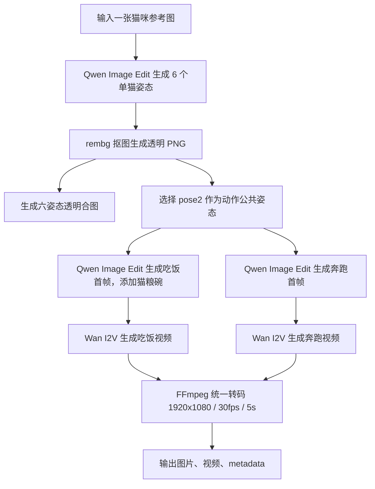

# 单图生成猫咪六姿态与双动作视频链路文档

## 1. 目标

本链路用于从一张猫咪参考图出发，自动生成同一只猫咪的六个中间姿态，并基于其中的 `pose2` 生成两段动作视频：

- 吃饭视频
- 奔跑视频

当前版本保留六个不同视角 / 姿态的透明中间图，动作视频先实现吃饭和奔跑。后续新增喝水、打滚、躺着等动作时，可以复用同一套六姿态中间结果和动作视频生成接口。

### 1.1 当前生产链路的完成优先边界

本文件后续章节保留早期 DashScope/Wan 双动作实验结构；当前 `local-video-api v2.26.52` 的正式上传链路以 `src/comfy_pet_pipeline/api/local_video.py` 及 `local_video_parts/` 为准。正式链路先生成 canonical，再为每个动作固定生成五轮 Qwen 候选并进入 SCAIL；首帧历史缓存只写审计、不参与固定五轮的读取或计数。

质量门分为两层：媒体与运行完整性是硬门，包括模型/进程成功、文件可读取、主体 alpha 可用、归一化输出存在和 SHA-256 一致；身份色盘、花纹、姿态、构图、毛面、背景及 canonical 内部洞属于视觉门。视觉门仍决定重试和严格候选排序，但预算耗尽后不再终止任务：canonical 对最佳生成图使用非阻断语义抠图，动作从五轮可用生成候选中选最低风险者，以 `best_effort` 继续 SCAIL。上传原图只能提供身份锚定和回绘佐证，不能作为动作首帧或最终输出。

猫舔毛首帧使用职责分离的双输入：Image 1 是 canonical 身份和全部外观的唯一权威，Image 2 是去外观、单色的动作几何。Qwen 可全画布重绘，不能继承 Image 2 的颜色、材质或脸；首帧审核在局部抬爪门之前先以保持宽高比的全身轮廓注册识别横卧/直立等大姿态错误。SCAIL 输出再以首、中、末三帧对比参考与 driver 外观，明显灰模接管时最多三轮降低姿态强度重试；视觉审核耗尽后选择真实生成候选中的最低风险结果继续，不改变完成优先合同。

## 2. 本次产物

| 类型 | 路径 |
| --- | --- |
| 输入参考图 | [`1.jpg`](1.jpg) |
| 六姿态透明合图 | [`outputs/cat_two_action_pipeline_wan22_side_eat/poses/cat_6_poses_transparent_sheet.png`](outputs/cat_two_action_pipeline_wan22_side_eat/poses/cat_6_poses_transparent_sheet.png) |
| 动作使用姿态 | [`outputs/cat_two_action_pipeline_wan22_side_eat/poses/transparent/pose_02_transparent.png`](outputs/cat_two_action_pipeline_wan22_side_eat/poses/transparent/pose_02_transparent.png) |
| 吃饭首帧 | [`outputs/cat_two_action_pipeline_wan22_side_eat/videos/eat/keyframes/eat_keyframe_000.png`](outputs/cat_two_action_pipeline_wan22_side_eat/videos/eat/keyframes/eat_keyframe_000.png) |
| 吃饭视频 | [`outputs/cat_two_action_pipeline_wan22_side_eat/videos/eat/final/eat_5s_30fps_16x9.mp4`](outputs/cat_two_action_pipeline_wan22_side_eat/videos/eat/final/eat_5s_30fps_16x9.mp4) |
| 奔跑首帧 | [`outputs/cat_two_action_pipeline_wan22_side_eat/videos/run/keyframes/run_keyframe_000.png`](outputs/cat_two_action_pipeline_wan22_side_eat/videos/run/keyframes/run_keyframe_000.png) |
| 奔跑视频 | [`outputs/cat_two_action_pipeline_wan22_side_eat/videos/run/final/run_5s_30fps_16x9.mp4`](outputs/cat_two_action_pipeline_wan22_side_eat/videos/run/final/run_5s_30fps_16x9.mp4) |
| 总 metadata | [`outputs/cat_two_action_pipeline_wan22_side_eat/pipeline_metadata.json`](outputs/cat_two_action_pipeline_wan22_side_eat/pipeline_metadata.json) |

## 3. 媒体预览

### 3.1 输入参考图


### 3.2 六个中间透明姿态

生成的六个中间姿态均保留在 `outputs/cat_two_action_pipeline_wan22_side_eat/poses/transparent/`，合图如下：


### 3.3 吃饭视频

吃饭首帧：


吃饭视频预览帧：


吃饭视频文件：

[打开吃饭视频](outputs/cat_two_action_pipeline_wan22_side_eat/videos/eat/final/eat_5s_30fps_16x9.mp4)

<video controls width="720" src="outputs/cat_two_action_pipeline_wan22_side_eat/videos/eat/final/eat_5s_30fps_16x9.mp4"></video>

### 3.4 奔跑视频

奔跑首帧：


奔跑视频预览帧：


奔跑视频文件：

[打开奔跑视频](outputs/cat_two_action_pipeline_wan22_side_eat/videos/run/final/run_5s_30fps_16x9.mp4)

<video controls width="720" src="outputs/cat_two_action_pipeline_wan22_side_eat/videos/run/final/run_5s_30fps_16x9.mp4"></video>

## 4. 总体链路



## 5. 技术架构

### 5.1 分层设计

| 层级 | 文件 / 节点 | 职责 |
| --- | --- | --- |
| 姿态生成层 | [`pet_pose_generator.py`](pet_pose_generator.py) | 调用 Qwen 图像编辑生成六个猫咪姿态，下载图片，使用 `rembg` 去背景，生成透明合图和姿态 metadata |
| 动作视频层 | [`pet_video_i2v.py`](pet_video_i2v.py) | 生成动作首帧，提交 Wan 图生视频任务，下载 raw 视频，使用 FFmpeg 后处理 |
| 总控编排层 | [`pet_two_action_pipeline.py`](pet_two_action_pipeline.py) | 串联单图输入、六姿态生成、吃饭视频、奔跑视频，并写入总 metadata |
| ComfyUI 节点层 | [`ComfyUI-DashScope-PetVideo-TwoActions/nodes/two_action_pipeline.py`](ComfyUI-DashScope-PetVideo-TwoActions/nodes/two_action_pipeline.py) | 在 ComfyUI 中封装为一个节点，支持图片路径或 `Load Image` 上传输入 |
| ComfyUI 部署层 | [`ComfyUI/custom_nodes/ComfyUI-DashScope-PetVideo-TwoActions`](ComfyUI/custom_nodes/ComfyUI-DashScope-PetVideo-TwoActions) | 已复制到 ComfyUI 自定义节点目录并加载 |

### 5.2 模型与工具

| 模块 | 使用能力 |
| --- | --- |
| 图像编辑 | 阿里百炼 / DashScope 云端 API 模型 `qwen-image-edit` |
| 视频生成 | 阿里百炼 / DashScope 云端 API 模型 `wan2.2-i2v-flash` |
| 背景去除 | `rembg` |
| 视频转码 | `ffmpeg` |
| 编排环境 | `conda` 环境 `comfy-pet-video` |
| ComfyUI | `http://127.0.0.1:8188` |

注意：

- `qwen-image-edit` 是当前脚本调用的百炼 / DashScope 图像编辑 API 模型名称。
- `wan2.2-i2v-flash` 是当前脚本调用的百炼 / DashScope 图生视频 API 模型名称。
- 阿里已有 Qwen-Image / Qwen-Image-Edit、Wan 系列开源模型；本链路当前不走本地权重推理，而是通过百炼 / DashScope 云端 API 调用对应模型能力。

### 5.3 可替换的开源方向

如果后续要改成本地开源方案，可以拆成两类替换：

| 当前云端模块 | 可替换方向 | 说明 |
| --- | --- | --- |
| `qwen-image-edit` | Qwen-Image / Qwen-Image-Edit 开源权重、FLUX Kontext、IP-Adapter 等 | 用于生成六姿态图和动作首帧 |
| `wan2.2-i2v-flash` | Wan2.1 / Wan2.2 等已公开权重的 I2V 方案 | 用于本地图生视频，但需要显存和环境重新适配 |

本地化后，ComfyUI 节点层可以保持类似输入输出结构，只需要把 `pet_pose_generator.py` 和 `pet_video_i2v.py` 内部的云端 API 调用替换为本地推理调用。

### 5.4 当前输出规格

| 项目 | 规格 |
| --- | --- |
| 姿态图数量 | 6 张 |
| 姿态图格式 | PNG |
| 姿态图背景 | 透明背景 |
| 动作公共姿态 | `pose_02_transparent.png` |
| 视频数量 | 2 段 |
| 视频动作 | 吃饭、奔跑 |
| 视频背景 | 白色干净背景 |
| 视频分辨率 | 1920x1080 |
| 视频帧率 | 30fps |
| 视频时长 | 5 秒 |
| 视频帧数 | 150 帧 |
| 视频编码 | H.264 MP4 |

## 6. 核心脚本说明

### 6.1 `pet_pose_generator.py`

主要函数：

```python
generate_pose_sheet(
    image_path=...,
    key_file=...,
    output_dir=...,
    output_count=6,
    size="1024*1024",
    model="qwen-image-edit",
)
```

处理流程：

1. 读取 `apikey.txt` 或环境变量 `DASHSCOPE_API_KEY`
2. 对六个姿态分别调用 Qwen 图像编辑
3. 下载六张 raw 图片
4. 使用 `rembg` 生成六张透明 PNG
5. 生成 `cat_6_poses_transparent_sheet.png`
6. 写入 `generation_metadata.json`

### 6.2 `pet_video_i2v.py`

已支持两个动作：

- `generate_eating_video`
- `generate_running_video`

每个动作包含两步：

1. 使用 Qwen 图像编辑生成动作首帧
2. 使用 Wan I2V 生成 5 秒视频并用 FFmpeg 统一输出规格

吃饭动作会在首帧中加入猫粮碗。奔跑动作会生成侧身跑动姿态，并要求镜头固定、全身在画面内。

### 6.3 `pet_two_action_pipeline.py`

总控入口：

```python
generate_two_action_videos(
    image_path=Path("1.jpg"),
    key_file=Path("apikey.txt"),
    output_dir=Path("outputs/cat_two_action_pipeline_wan22_side_eat"),
    image_model="qwen-image-edit",
    video_model="wan2.2-i2v-flash",
    duration=5,
    action_pose_index=2,
)
```

该函数会返回：

- 六姿态合图路径
- 六个透明姿态图路径
- 动作使用的 pose2 路径
- 吃饭视频结果
- 奔跑视频结果
- 总 metadata 路径

## 7. ComfyUI 节点

新增节点：

```text
DashScope Cat Two Action Videos
```

节点类别：

```text
DashScope/PetVideo
```

节点 Python 名称：

```text
DashScopePetTwoActionVideos
```

输入：

| 输入名 | 说明 |
| --- | --- |
| `image_path` | 图片路径。不连接上传图片时使用 |
| `reference_image` | 可选图片输入，可连接 ComfyUI 的 `Load Image` |
| `api_key_file` | API key 文件路径，默认 `D:/gogelila/comfy/apikey.txt` |
| `output_dir` | 输出目录 |
| `image_model` | 图像编辑模型 |
| `video_model` | 图生视频模型 |
| `pose_size` | 姿态图生成尺寸 |
| `resolution` | Wan 视频生成分辨率，当前默认 `720P`，后处理到 1920x1080 |
| `duration` | 视频时长 |
| `seed` | 随机种子 |
| `action_pose_index` | 用于动作视频的姿态编号，默认 `2` |

输出：

| 输出名 | 说明 |
| --- | --- |
| `pose_sheet_path` | 六姿态合图路径 |
| `pose_metadata_path` | 姿态 metadata 路径 |
| `action_pose_path` | 动作使用的透明姿态路径 |
| `eat_video_path` | 吃饭最终视频路径 |
| `run_video_path` | 奔跑最终视频路径 |
| `pipeline_metadata_path` | 总 metadata 路径 |

ComfyUI 已加载确认：

```text
http://127.0.0.1:8188/object_info/DashScopePetTwoActionVideos
```

## 8. 命令行运行方式

在 `D:\gogelila\comfy` 下执行：

```powershell
D:\Anaconda3\envs\comfy-pet-video\python.exe pet_two_action_pipeline.py `
  --image 1.jpg `
  --key-file apikey.txt `
  --output-dir outputs/cat_two_action_pipeline_wan22_side_eat `
  --duration 5 `
  --resolution 720P `
  --timeout-seconds 1200
```

## 9. 输出目录结构

```text
outputs/cat_two_action_pipeline_wan22_side_eat/
  pipeline_metadata.json
  poses/
    cat_6_poses_transparent_sheet.png
    generation_metadata.json
    raw/
      pose_01_raw.png
      pose_02_raw.png
      pose_03_raw.png
      pose_04_raw.png
      pose_05_raw.png
      pose_06_raw.png
    transparent/
      pose_01_transparent.png
      pose_02_transparent.png
      pose_03_transparent.png
      pose_04_transparent.png
      pose_05_transparent.png
      pose_06_transparent.png
  videos/
    eat/
      keyframes/eat_keyframe_000.png
      raw_videos/eat_raw.mp4
      final/eat_5s_30fps_16x9.mp4
      metadata/eat_video_metadata.json
    run/
      keyframes/run_keyframe_000.png
      raw_videos/run_raw.mp4
      final/run_5s_30fps_16x9.mp4
      metadata/run_video_metadata.json
  preview/
    eat_contact_sheet.jpg
    run_contact_sheet.jpg
```

## 10. 验证记录

本次已使用 `ffprobe` 校验最终视频：

| 视频 | 分辨率 | 帧率 | 时长 | 帧数 |
| --- | --- | --- | --- | --- |
| 吃饭 | 1920x1080 | 30fps | 5.000000s | 150 |
| 奔跑 | 1920x1080 | 30fps | 5.000000s | 150 |

同时已生成视频预览拼图：

- [`outputs/cat_two_action_pipeline_wan22_side_eat/preview/eat_contact_sheet.jpg`](outputs/cat_two_action_pipeline_wan22_side_eat/preview/eat_contact_sheet.jpg)
- [`outputs/cat_two_action_pipeline_wan22_side_eat/preview/run_contact_sheet.jpg`](outputs/cat_two_action_pipeline_wan22_side_eat/preview/run_contact_sheet.jpg)

## 11. 后续扩展

后续新增动作时建议沿用当前动作模块结构：

1. 在 `pet_video_i2v.py` 中新增动作首帧 prompt
2. 新增动作视频 prompt
3. 新增 `generate_xxx_video` 函数
4. 在 `pet_two_action_pipeline.py` 中挂载新动作
5. 在 ComfyUI 节点中增加对应输出路径

优先可加动作：

- 喝水：需要水碗首帧
- 打滚：建议首尾帧或多段视频控制
- 躺着：动作幅度小，稳定性高
- 挥爪：可直接复用 pose5
