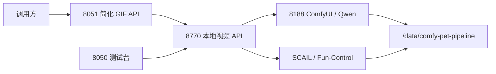

# 项目目录与数据边界

## 目标结构

| 目录 | 内容 | 是否入库 |
| --- | --- | --- |
| `src/comfy_pet_pipeline/` | API、质量检查、主体替换、身份和媒体代码 | 是 |
| `web/platform/` | 8050 测试台页面 | 是 |
| `profiles/` | Profile JSON、标准清单，不含生成媒体 | 是 |
| `extensions/comfyui/` | 项目维护的 ComfyUI 节点 | 是 |
| `apps/` | 独立应用 | 是 |
| `tests/unit/` | 纯 CPU、快速单元测试 | 是 |
| `tests/integration/` | API 与模块集成测试，不提交真实 GPU 任务 | 是 |
| `tests/regression/` | 历史图集清单、SHA 与预期结论，不含媒体 | 是 |
| `tests/e2e/` | 显式执行的长耗时链路脚本 | 是 |
| `tools/` | 资产构建、诊断、审计、实验及旧版工具 | 是 |
| `ops/` | systemd、Nginx、环境变量示例及运维脚本 | 是 |
| `/etc/comfy-pet-pipeline/` | API key、密码和机器级配置 | 否 |
| `/opt/comfyui/current/` | ComfyUI 运行时代码 | 否 |
| `/opt/comfyui/custom-nodes/` | 第三方 ComfyUI 节点 | 否 |
| `/data/comfy-pet-pipeline/` | 模型、输入、输出、任务、Profile 媒体与归档 | 否 |
| `/data/comfy-pet-pipeline/archive/regression-gallery/` | 从历史任务固化的回归媒体语料 | 否 |
| `/data/comfy-pet-pipeline/outputs/regression_gallery/` | 快速输入图集与 live 完成性 canary 报告 | 否 |

## 兼容入口

根目录的 `local_video_api.py`、`simple_pet_gif_api.py`、`pet_generation_platform.py` 等文件只负责把旧模块名映射到 `src.comfy_pet_pipeline`。现有脚本和历史测试可以继续使用旧导入；新模块不得再依赖这些入口。

## 冗余文件处理

- `.codex-staging/`、`.codex-deploy/`、`__pycache__/` 和 `.pytest_cache/` 是可重建临时文件，清理后不归档。
- 历史 `.codex-backups/`、`.codex-validation/`、根目录备份副本、旧 `backups/` 与实验素材迁移到 `/data/comfy-pet-pipeline/archive/`，不留在源码树。
- 模型和 ComfyUI 任务数据始终留在 `/data/comfy-pet-pipeline/`，不得提交到 Git。
- 环境文件从仓库根目录迁移到 `/etc/comfy-pet-pipeline/`，权限固定为 `0600`。

## 运行关系

## 变更规则

1. 生产代码改在 `src/`，兼容入口只在导入协议变化时调整。
2. 不在 import 时启动生成任务；端到端生成只能由 `tests/e2e/` 或显式 API 请求触发。
3. 新的凭据只增加到 `/etc/comfy-pet-pipeline/`，并在 `ops/env/` 增加无值示例。
4. 运行服务统一使用 `src.comfy_pet_pipeline...` 入口，避免兼容文件成为新的依赖。
5. 每次仓库修改后先运行 `bash ops/scripts/verify-change.sh`，再在队列为空时运行 `.venv/bin/python ops/scripts/run-live-stability-gallery.py --suite smoke`；默认必须各提交一次猫 `eating + grooming` 和狗 `eating + standing`。历史语料只能按清单 SHA 从 `/data` 读取，不复制到源码树。
