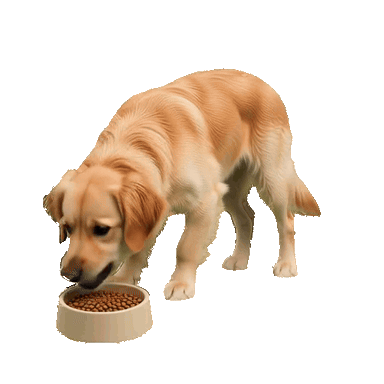
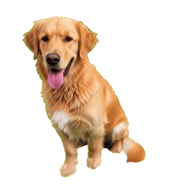

# 宠物动画 · 历史样例与演示

| 进食 | 站立 |
| --- | --- |
|  |  |

两段动画取自本地项目 `diagnostics/20260915-af16c54b00/result-v22669/` 中的真实透明 GIF 输出，分别对应 `eating_subject_replacement_transparent_512.gif` 和 `standing_subject_replacement_transparent_512.gif`。发布副本缩至 384 像素、10 FPS，并保留透明背景，用于文档预览。原始任务记录、输入照片、日志和其他输出没有加入仓库。

这是 **v2.26.69 历史样例**，不是本次新跑的 smoke，也不是每个品种或每次输入都能达到的效果承诺。`workflow.svg` 是简化流程图；运行与交付行为以当前代码、API 文档和部署配置为准。

在已部署环境中：上传正面图 → 补充侧面图（可选）→ 提交任务 → 查询进度 → 预览并下载可用动画。猫默认是 `eating + grooming`，狗默认是 `eating + standing`。见 [简化 API](../api/SIMPLE_PET_GIF_API.md) 与 [本地视频 API](../api/LOCAL_VIDEO_API.md)。
